# Pipelining

## Single-Cycle vs. Multi-Cycle Datapath

In a single-cycle datapath, we have a true **atomic** fetch/execute loop, in that the loop completes one instruction every cycle. We also have hardwired control; opcodes directly correspond to control signals. 

The advantage is a low CPI (cycles/instruction) by definition, but that comes with a long clock period to accomodate the slowest instruction.

A multi-cycle datapath attacks a slow clock. The fetch/execute loop completes one instruction over multiple cycles and we have micro-coded control that "stages" control signals. The main difference is that instructions can take different numbers of cycles.

By design, it is the opposite of single-cycle, in that we have a short clock period and high CPI.

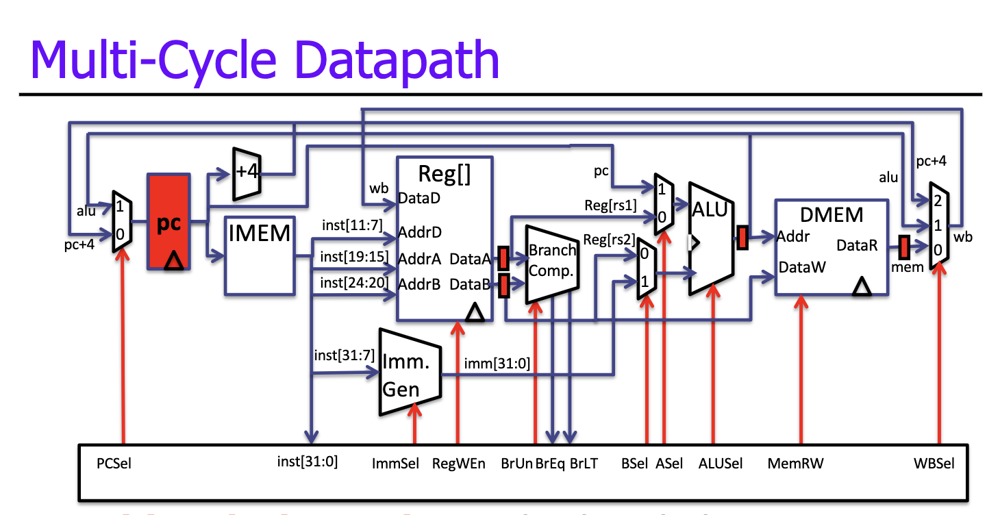

### Performance

> Single-Cycle

* Clock period = 50ns, CPI = 1
* Performance = 50ns/instruction

> Multi-Cycle

* Branch: 20% (3 cycles), load: 20% (5 cycles), ALU: 60% (4 cycles)
* Clock period = 11 ns, CPI = (0.2\*3) + (0.2\*5) + (0.6\*4) = 4
* Performance = 44ns/instruction

## Pipelining Basics

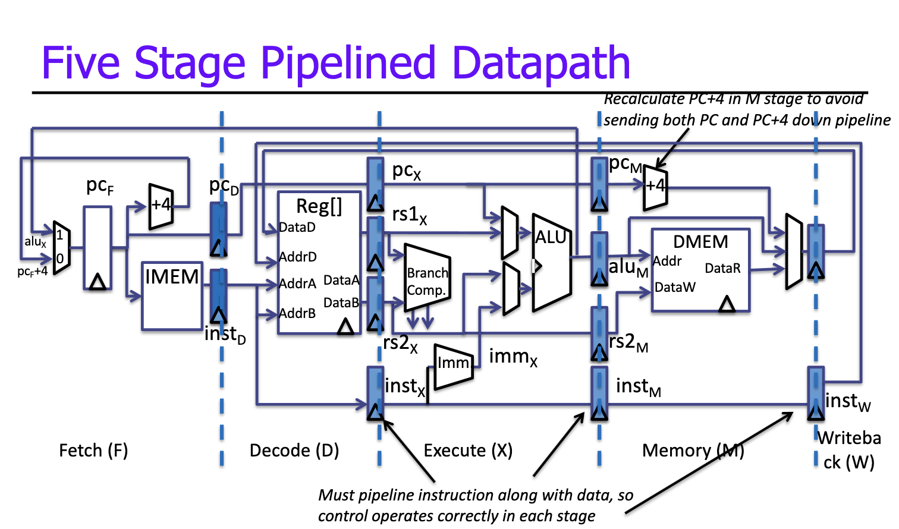

In this datapath we have five stages: Fetch, Decode, Execute, Memory, Writeback. The registers are named by the stages they separate (PC, F/D, D/X, X/M, M/W).

The goal of pipelining is to cut a datapath into $N$ stages, here $N = 5$.

* Clock period = $\text{max}(t_\text{IMEM}, t_\text{REGFILE}, t_\text{ALU}, t_\text{DMEM})$
* Base CPI = 1, Actual CPU > 1, pipeline often stalls.
* Individual instruction latency increases (pipeline overhead), which is OK

### Terminology

* Scalar pipeline: one instruction per stage per cycle.
* In-order pipeline: instructions enter execute stage in order.
* Pipeline depth: number of pipeline stages.

### Pipeline Performance

> 5-Stage Pipeline

* Clock period = 12 ns; approx. (50 ns/5 stages) + overheads
* CPI = 1, Performance = 12 ns/instruction
* In actuality, CPI = 1 + some penalty for pipelining:
  * CPI = 1.5
  * Performance = 18 ns/instruction
  * Much higher performance than single or multi cycle.

## Dependencies and Hazards

**Dependence** is the relationship between two instructions. There are data dependencies (two instructions using the same storage location) and control dependencies (one instruction affecting the execution of another).

Typically we enforce **program order**, making older instructions go before younger ones. This happens naturally in single/multi-cycle designs but not necessarily so in a pipeline.

This is where **hazards** come in, the combination of dependence and wrong instruction order.

## Structural Hazards

Structural hazards occur when two instructions try to use the same hardware resource at the same item.

To fix structural hazards, instructions take turns to use resources, requiring some to stall, and/or we can add more hardware (always a valid solution!).

### Example: Regfile

Each instruction can read up to two operands in the decode stage and can write one value in the writeback stage. We can avoid strutural hazards by having separate "ports", which allows three accesses per cycle simulatneously.

## Data Hazards

Consider executing a sequence of register-register instructions of type: $r_k \leftarrow r_i \ \text{op} \ r_j$

### Data-dependence

$r_3 \leftarrow r_1 \ \text{op} \ r_2 \ \text{(Read-after-Write)} \\
r_4 \leftarrow r_3 \ \text{op} \ r_4 \ \text{(Read-after-Write Hazard)}$

### Anti-dependence

$r_3 \leftarrow r_1 \ \text{op} \ r_2 \ \text{(Write-after-Read)} \\
r_1 \leftarrow r_4 \ \text{op} \ r_5 \ \text{(Write-after-Read Hazard)}$

### Output-dependence

$r_3 \leftarrow r_1 \ \text{op} \ r_2 \ \text{(Write-after-Write)} \\
r_3 \leftarrow r_6 \ \text{op} \ r_7 \ \text{(Write-after-Write Hazard)}$

We have three approaches for data hazards:

* **Interlock**: Wait for hazard to clear by blocking the dependent instruction, effectively stalling in hardware.
* **Bypass**: Resolve hazard earlier by bypassing value as soon as available.
* **Speculate**: Guess the value, correct if guess was incorrect.

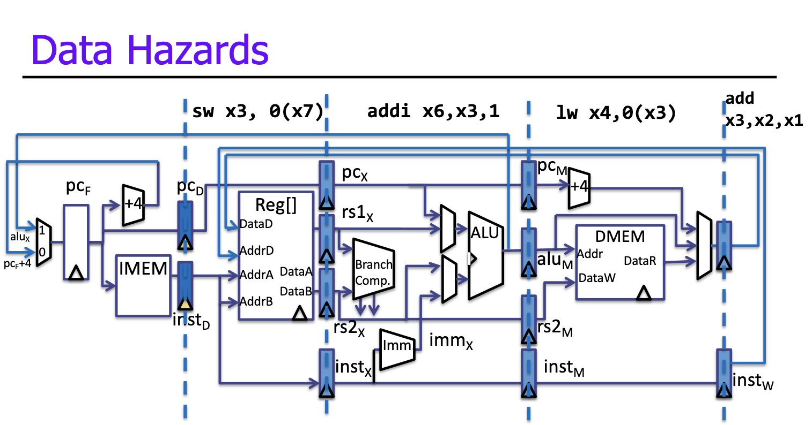

> Would this sequence execute correctly on this pipeline?

Analyzing the datapath:

* `add` is writing its result into `x3` in the current cycle.
* `lw` read `x3` two cycles ago and has the wrong value.
* `addi` read `x3` one cycle ago and has the wrong value.
* `sw` is reading `x3` this cycle, might have the correct value but not in our case.

> Are memory data hazards a problem for this pipeline?

No:

* `lw` follows `sw` to the same address next cycle, gets the right value.
* Why? `DMEM` read/write always takes place in the same stage.

> Are data hazards a problem for this pipeline?

Yes, through registers, since the register write is three stages after the register read.

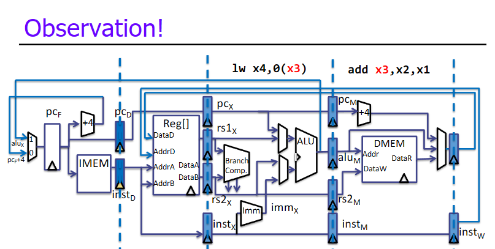

Tehnically, the situation is broken:

* `lw x4, 0(x3)` has already read `x3` from the regfile
* `add x3, x2, x1` has yet to write `x3` to the regfile

But fundamentally, everything is fine:

* `lw x4, 0(x3)` hasn't used `x3` yet
* `add x3, x2, x1` has already computed `x3`

## Forwarding

**Forwarding (bypassing)** supplies a result directly from a pipeline register instead of waiting for register-file writeback. Multiplexers replace stale operands read in D with the correct values when they are used.

The path names identify the producer's and consumer's stages **in the same cycle**.

### MX Forwarding

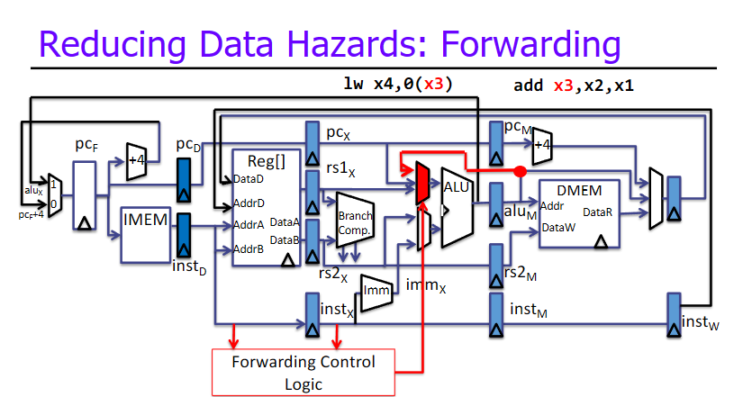

> An example of MX (memory-execute) forwarding.

```asm
add x3, x2, x1
lw  x4, 0(x3)
```

* `add` computes `x3` in X and saves it in X/M.
* Next cycle, `add` is in M and `lw` is in X. MX forwarding supplies the new `x3` for the load's address calculation, avoiding a stall.
* The forwarded value is the ALU result, not data read from memory.

### WX and WM Forwarding

* **WX**: W to X. Supplies a writeback value to an execute-stage operand.
* **WM**: W to M. Supplies a writeback value as the data for a store.

> WX example: one independent instruction separates producer and consumer.

```asm
add x1, x2, x3
lw  x5, 0(x7)
sub x2, x1, x4
```

When `sub` reaches X, `add` is in W; WX forwarding supplies `x1` from M/W.

> WM example: a store needs its data in M, rather than X.

```asm
add x1, x2, x3
sw  x1, 0(x5)
```

When `sw` reaches M, `add` is in W; WM forwarding supplies the new `x1`. The store's address base (`x5`) is needed earlier, in X.

### Forwarding Control

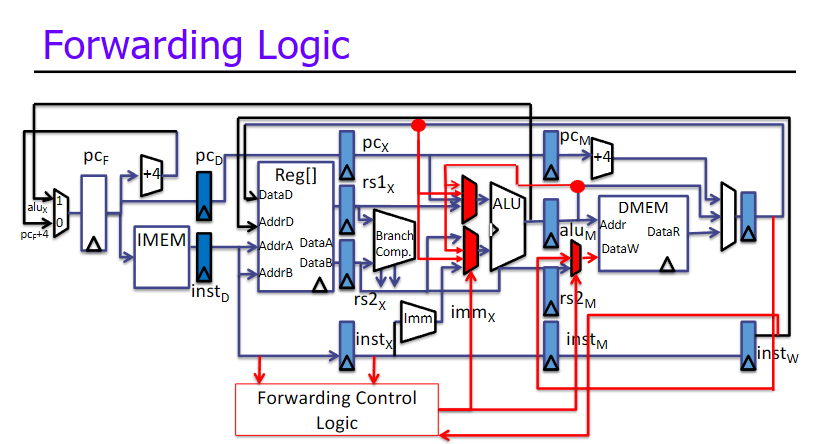

Compare source registers with older instructions' destination registers and select each operand independently:

* Use MX when the matching result in M is available; otherwise use WX for a matching result in W.
* If both match, the newer producer in M takes priority. Stall if its result is not ready; the older W value is incorrect.
* Check that the producer writes a register and that its destination is not `x0`.
* Forwarding is also needed for branch comparison operands.

## Load-Use Hazards and Stalling

> Have we prevented all data hazards?

No; consider a load immediately followed by a dependent `add`:

```asm
lw  x3, 4(x2)
add x4, x2, x3
```

* An ALU result is available after X, but loaded data is only available after M. A load's X/M value is its **address**.
* Without a stall, `add` needs `x3` in X while `lw` is still reading it in M.
* Insert **one stall cycle**, then use WX forwarding when `lw` is in W and `add` is in X.

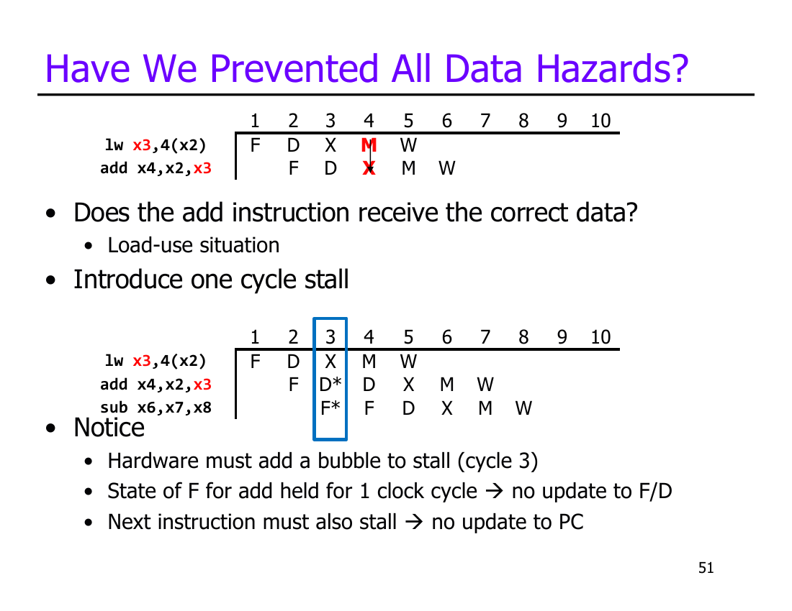

`D*` and `F*` mark stalled stages: the dependent instruction stays in D, and the following instruction stays in F.

### Inserting a Stall

* Insert a `nop` into D/X: a **bubble** that changes no architectural state.
* Disable F/D and PC write enables to hold Decode and Fetch.
* Let older instructions advance, then re-evaluate the hazard next cycle.

### Detecting Load-To-Use Dependencies

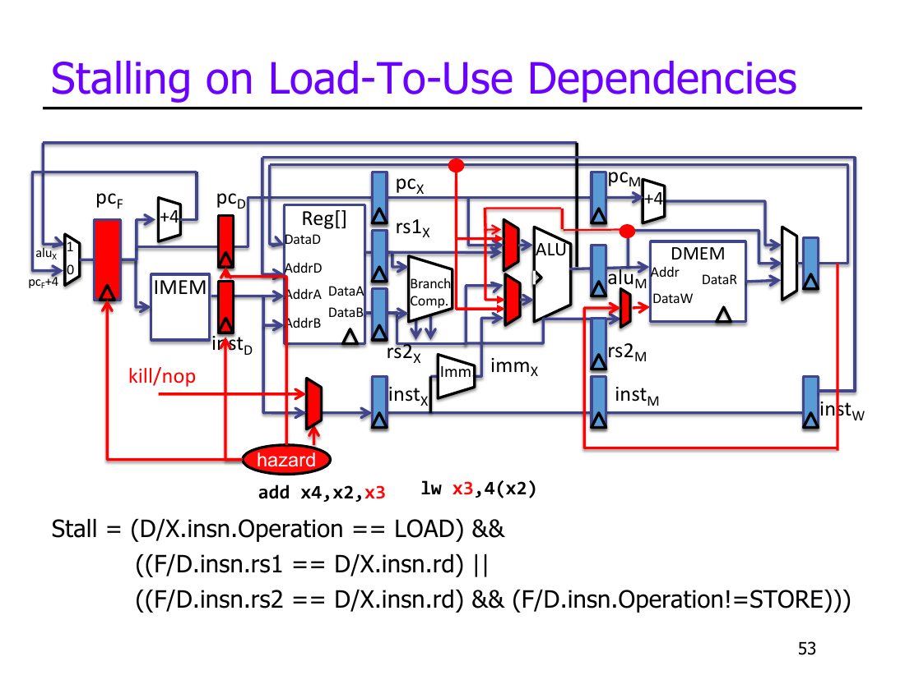

The slide's stall condition checks for a load in X whose destination is needed by the instruction in D:

```text
Stall = (D/X.insn.Operation == LOAD) &&
        ((F/D.insn.rs1 == D/X.insn.rd) ||
         ((F/D.insn.rs2 == D/X.insn.rd) &&
          (F/D.insn.Operation != STORE)))
```

* A store's `rs1` (address base) is needed in X and can require a stall.
* Its `rs2` (store data) is needed in M; WM forwarding avoids this stall.
* Implementation checks must exclude `x0` and source fields the instruction does not use.

### Load-Use Performance

* Instruction mix: branch 20%, load 20%, store 10%, other 50%.
* 50% of loads require a one-cycle load-use stall; assume no branch penalty.
* CPI = $1 + (0.20 \times 0.50 \times 1) = 1.1$.

## Pipelining and Multi-Cycle Operations

A four-cycle multiply uses separate stages P0-P3 feeding W, controlled by a pipeline **FSM**. A pipelined multiplier can start a new multiply each cycle even though each result takes four execution cycles.

### RAW and Structural Hazards

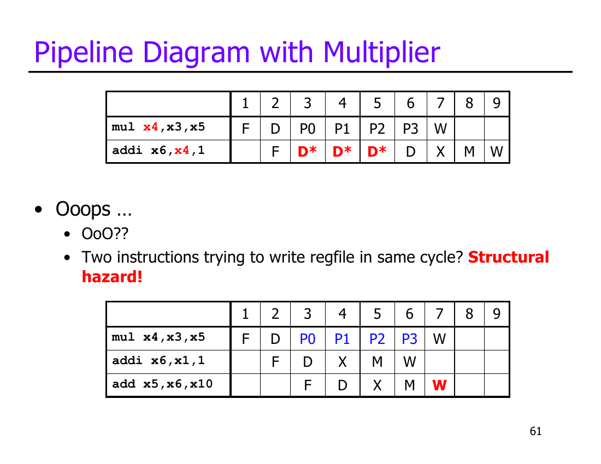

* Upper diagram: `addi` needs the multiply result, so it stalls in D for three cycles, then uses WX forwarding in cycle 7.
* Lower diagram: independent shorter instructions can finish before `mul`. Both `mul` and `add` reach W in cycle 7, conflicting over the single write port: a **structural hazard**.
* Control must stall an instruction or provide sufficient write ports.

### WAW Hazards

```asm
mul  x4, x3, x5
addi x4, x1, 1
# ...
add  x10, x4, x6
```

`addi` writes `x4` in cycle 6, but the older `mul` overwrites it in cycle 7. The later `add` incorrectly receives the multiply result: a **write-after-write hazard**.

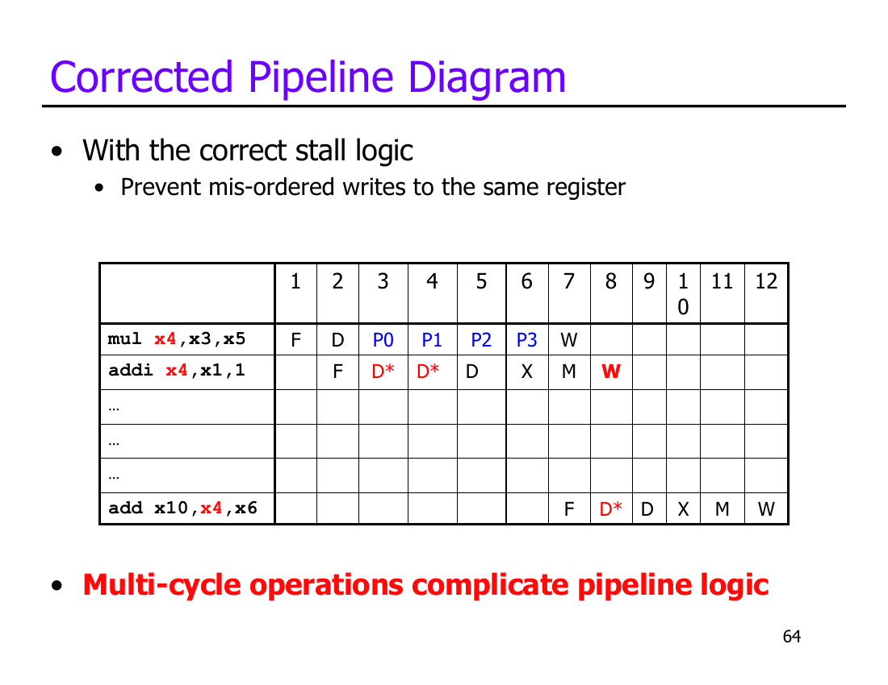

Stall `addi` for two cycles so it writes in cycle 8, after `mul`. The later `add` also waits for the correct value. Multi-cycle operations require checks for write order and resource conflicts as well as RAW hazards.

## Control Dependencies and Branches

* **Taken**: the branch condition is satisfied; execution continues at the target.
* **Not taken**: execution continues at the next sequential instruction.
* In this pipeline, F knows the PC, D knows the opcode and offset, and X resolves the branch condition or register-based jump target.

> What do we fetch before the branch outcome is known?

* Stall until X resolves the branch: a two-cycle penalty.
* Or assume **not taken** and continue fetching sequential instructions.
* If the branch is taken, redirect the PC and **flush/squash** the two younger instructions in F and D, inserting bubbles into F/D and D/X.
* Those younger instructions have not yet changed registers or memory, so recovery is straightforward.
* A `jalr` target also becomes available in X, giving the same two-cycle delay without prediction.

### Branch Performance

Assume 20% of instructions are branches, 75% are taken, and each taken branch costs two cycles under predict-not-taken:

* CPI = $1 + (0.20 \times 0.75 \times 2) = 1.3$.
* This is a 30% increase in cycles per instruction over the ideal CPI of 1.

## Speculative Execution and Branch Prediction

**Speculation** starts work before all required information is known. Correct guesses avoid stalls; incorrect guesses require flushing the wrong instructions and restoring correct execution.

**Dynamic branch prediction** learns from previous branch outcomes and starts fetching from the predicted next PC. It needs:

* A **direction predictor**: taken or not taken?
* A **target predictor**: where does a taken branch go?
* Recovery when either prediction is wrong.

### Indexing Predictor Tables

* An $N$-entry table needs $\log_2 N$ index bits.
* For the slides' four-byte-aligned instructions, skip the lowest two PC bits and use the next low bits.
* **Aliasing**: different PCs map to the same entry and interfere with predictions.
* Update predictor state using resolved outcomes and targets; predictions may be wrong, but recovery must remain correct.

### Branch History Table (BHT)

The simplest direction predictor stores one bit per indexed entry: `0` = not taken, `1` = taken. It predicts the branch will behave as it did last time.

> Why does a one-bit predictor struggle with repeated loops?

For a repeating `T T T N` pattern, it misses the loop exit (`N`) and the first taken branch of the next loop execution: two mispredictions per loop execution.

### Two-Bit Saturating Counters

Use four states instead of one bit:

| Counter | State | Prediction |
| --- | --- | --- |
| 0 | Strongly not taken (N) | Not taken |
| 1 | Weakly not taken (n) | Not taken |
| 2 | Weakly taken (t) | Taken |
| 3 | Strongly taken (T) | Taken |

* Increment on taken, decrement on not taken; saturate at 0 and 3.
* **Hysteresis**: from a strong state, two opposite outcomes are needed to reverse the prediction.
* After warm-up, a `T T T N` loop pattern typically misses only the exit; one `N` does not reverse a strongly taken prediction.

### Correlating Predictors

A **branch history register (BHR)** records recent outcomes. Use the PC and history together to select a prediction, allowing different predictions for different histories.

* Branch outcomes can depend on previous branches' outcomes.
* $k$ history bits distinguish $2^k$ patterns.
* For the slides' repeating `T T T N` example, two history bits cannot distinguish every case; three bits learn the pattern and eliminate misses after training.
* Longer histories require more predictor storage.

### Hybrid Predictors

A **hybrid (tournament) predictor** combines simple and history-based predictors. A chooser learns which predictor works better for each branch, reserving more complex prediction for branches that benefit from it.

## Predicting Targets During Fetch

> Why predict in F instead of D?

Prediction in D still loses one fetch cycle on a taken branch, even with a correct prediction. Prediction in F can avoid that penalty.

### Branch Target Buffer (BTB)

A **BTB** records branch PCs and their taken targets, and is accessed in parallel with instruction memory during Fetch.

* A matching PC tag identifies a previously recorded branch and supplies its predicted target.
* For a conditional branch, the direction predictor selects the target or `PC+4`.
* With no matching entry, fetch `PC+4`.
* Resolved branches update the stored target and tag.

Direct branch targets are stable because they are encoded in the instruction. Register-based targets can change, causing target mispredictions.

### Return Address Stack (RAS)

A **RAS** predicts procedure return targets:

* Push the return address (`PC+4` here) on a call.
* Pop it as the predicted target on a return.
* Pre-decode information identifies calls and returns early; not every `jalr` is a return.

Together, the BTB, direction predictor, and RAS provide the next-PC prediction during Fetch. A correct prediction avoids the branch penalty.

### Prediction Performance

For 20% branches and a two-cycle misprediction penalty:

* 75% accuracy: CPI = $1 + (0.20 \times 0.25 \times 2) = 1.1$.
* 95% accuracy: CPI = $1 + (0.20 \times 0.05 \times 2) = 1.02$.
* Deeper pipelines increase the misprediction penalty; the slides note penalties of 10+ cycles.

These calculations isolate branch penalties; load-use stalls add their own contribution to CPI.

## Predication

**Predication** replaces selected branches with conditionally executed instructions that are fetched regardless of the condition. If the predicate is false, the instruction is **annulled** and has no architectural effect.

* Full predication uses predicate registers or condition codes to control instructions, including stores.
* A set-predicate instruction replaces the branch; instructions outside the conditional block proceed normally.
* Benefit: fewer branches and mispredictions, with less pressure on predictor tables.
* Cost: false-predicate instructions still consume pipeline resources.
* Predication may help when branch penalties are high, but can hurt when prediction is already accurate.

## Interrupts and Exceptions

An interrupt transfers control to a handler, then allows execution to resume. Unlike a normal function call, the interrupted program cannot prepare for the transfer.

### Terminology

* **Exception (synchronous interrupt)**: tied to a particular instruction, such as an illegal opcode or invalid memory address. A faulting instruction cannot finish normally and must be handled.
* **Interrupt (asynchronous)**: an external event not tied to a particular instruction. Handling can be delayed to a suitable instruction boundary, but not indefinitely.
* **Trap/system call**: an instruction deliberately requests an exception to enter a handler.

> Why not just use `jal` for a system call?

`jal` changes control flow but does not perform the controlled privilege transition needed to enter an operating-system handler.

### Precise Interrupts and Exceptions

Even with overlapping execution, a **precise** interrupt or exception appears to occur between instructions:

* Older instructions have completed fully.
* Younger instructions have made no architectural changes.
* For a fault, the faulting instruction has not committed its effects.

This gives the handler a consistent state from which execution can resume.

### Exception Handling in a Five-Stage Pipeline

Exceptions can be detected in different stages:

| Stage | Example |
| --- | --- |
| F | Invalid instruction/PC address |
| D | Illegal opcode |
| X | Arithmetic overflow, if the ISA traps on it |
| M | Invalid data address |

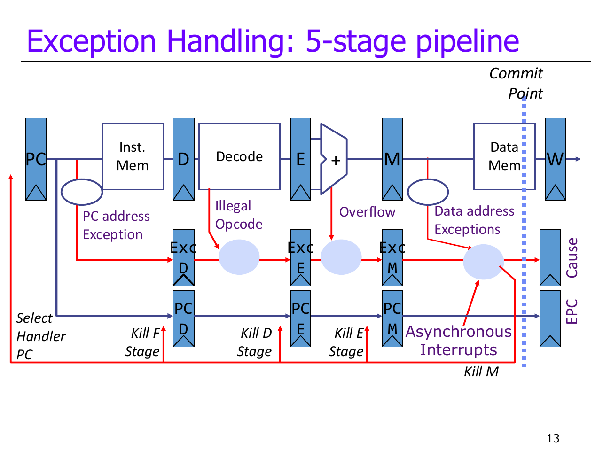

Choose a **commit point** before architectural state updates, including memory writes and register writeback. The slides use M, after checking for data-address exceptions but before allowing state changes.

> How do we handle exceptions detected in different stages?

* Carry each instruction's exception flags and PC through the pipeline to the commit point.
* Handle the oldest faulting instruction first; a younger exception must not overtake it.
* For multiple exceptions on the **same instruction**, an earlier-stage exception takes priority over a later-stage exception.
* Check external asynchronous interrupts at the commit point too, preserving a precise instruction boundary.

### Entering the Handler

* Save the interrupted/faulting instruction address in **EPC (Exception PC)** so it is not lost when the PC changes.
* Save the reason in the **Cause** register.
* Suppress the affected instruction's state updates and flush younger instructions.
* Redirect the PC to the selected handler; let older instructions finish.

The essential requirement is to detect and prioritize the event **before irreversible state updates**.
