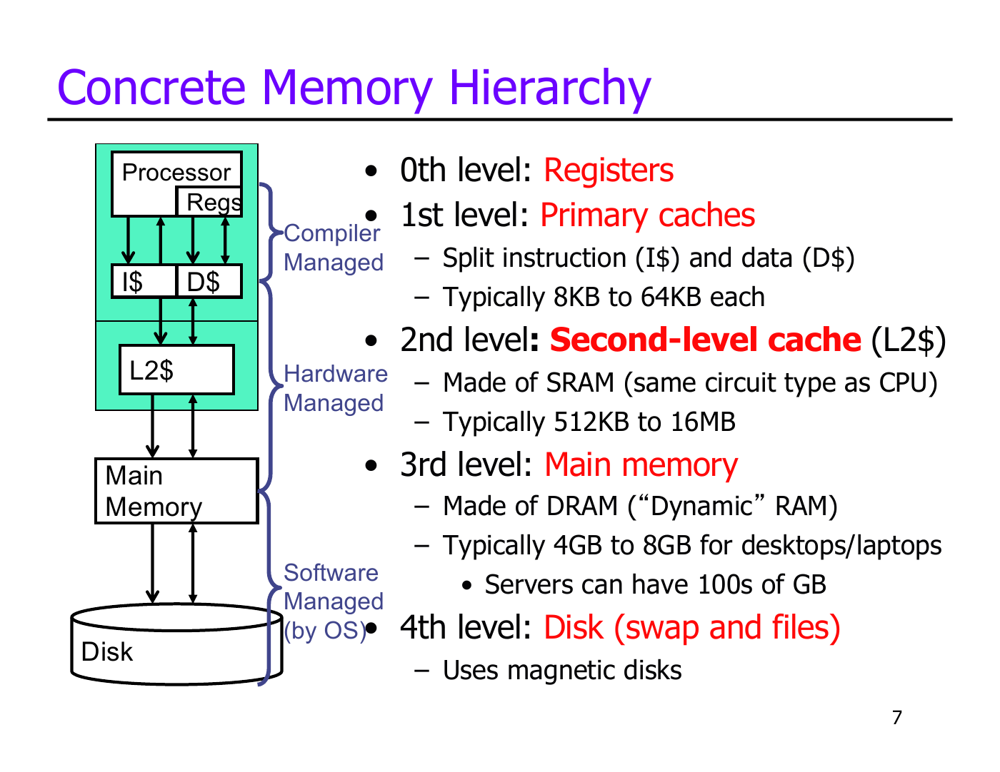
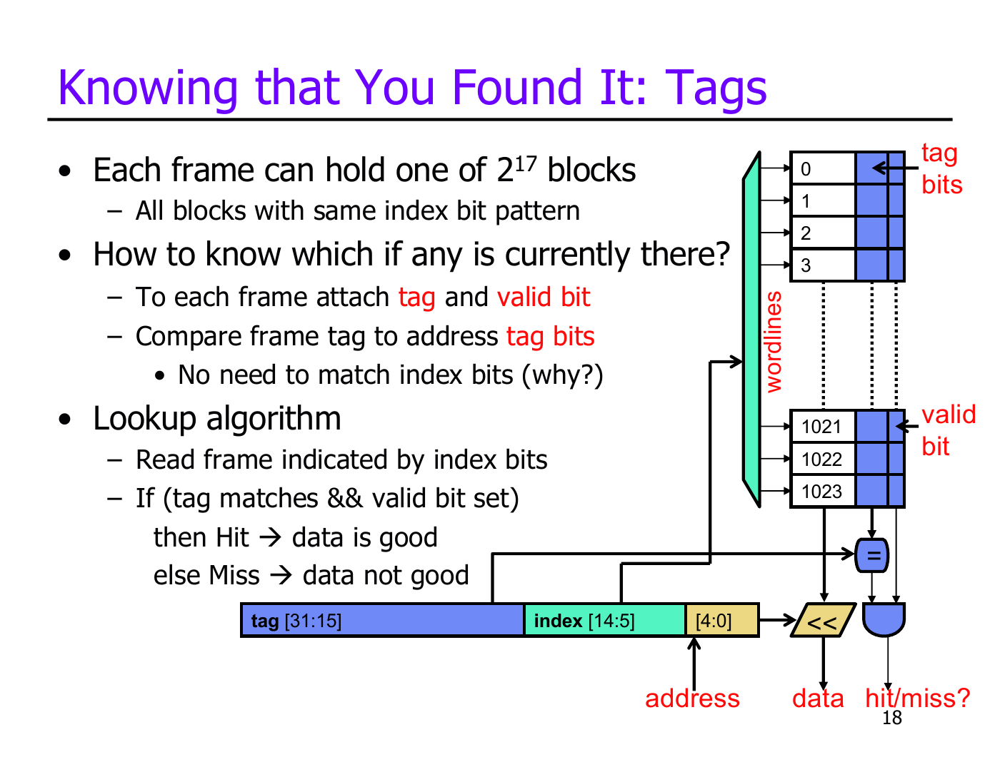
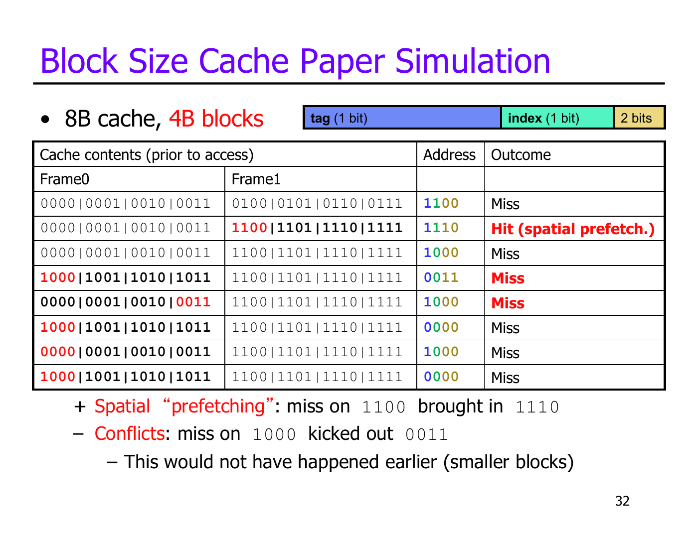
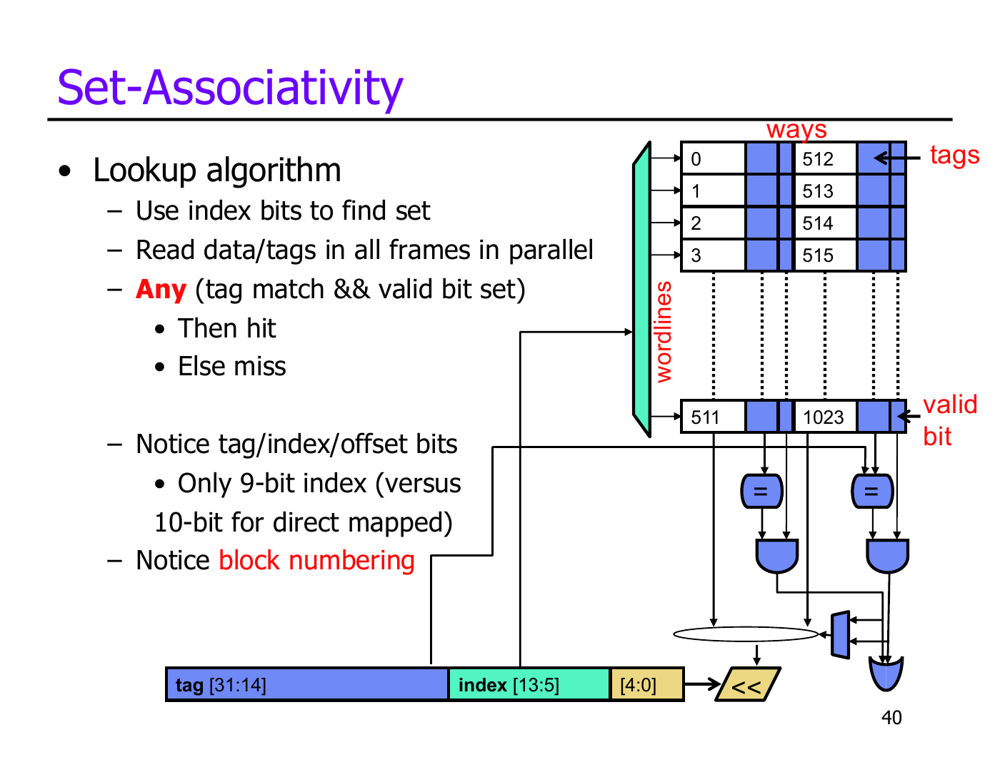
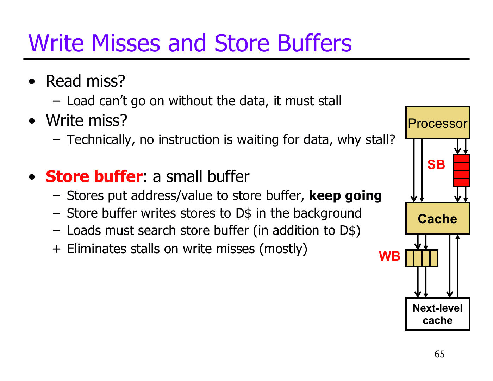

# Caches

## Memory Hierarchy

The memory hierarchy combines small, fast storage with larger, slower storage to reduce **average access time**.

* Upper levels: fast, small, expensive per byte.
* Lower levels: slow, large, cheap per byte.
* Frequently accessed data is kept near the CPU; transfers also depend on bus latency and bandwidth.

* Registers: managed through compiler-generated instructions.
* L1 instruction (I$) and data (D$) caches, followed by larger caches: hardware-managed SRAM.
* Main memory: DRAM. The OS manages movement between memory and disk storage.

### Locality

> Why does a hierarchy work?

* **Temporal locality**: recently accessed instructions or data are likely to be accessed again, such as loop instructions and variables.
* **Spatial locality**: nearby addresses are likely to be accessed soon, such as sequential instructions and array elements.
* Caching exploits temporal locality by retaining data, and spatial locality by fetching whole blocks.

## Cache Organization

A **cache block (line)** is the unit transferred between cache and the next level. A **frame** is a cache location that holds a block.

A memory array uses an address decoder to select a row through a **wordline**; data travels along **bitlines**. An array with $2^n$ entries needs $n$ index bits.

### Address Fields

For an $m$-bit byte address, cache data capacity $C$, block size $B$, and associativity $A$:

* Number of frames = $C/B$.
* Number of sets = $S = C/(B \times A)$.
* **Offset** = $\log_2 B$ bits: selects a byte within the block.
* **Index** = $\log_2 S$ bits: selects a set.
* **Tag** = $m - \text{index bits} - \text{offset bits}$: identifies the block.

Block sizes and set counts are normally powers of two, so fields can be extracted directly from the address.

### Direct-Mapped Lookup

In a **direct-mapped** cache, each block has exactly one possible frame.

* Use the index to select the frame.
* A **hit** requires a matching tag and a set **valid bit**.
* Otherwise, it is a **miss**; fetch the block from the next level.
* Index bits need no comparison: selecting the frame already accounts for them.

> Example: 32 KiB direct-mapped cache, 32 B blocks, 32-bit addresses.

* Frames = $32768/32 = 1024$.
* Offset: 5 bits `[4:0]`; index: 10 bits `[14:5]`; tag: 17 bits `[31:15]`.
* Capacity counts data only. Tags and status bits are extra storage.
* Tag + valid overhead = $(17+1) \times 1024 = 18432$ bits = 2.25 KiB, about 7% of data capacity.

### Handling a Miss

A cache-controller **FSM** remembers the address, requests the block from the next level, waits for it, then installs the data, tag, and valid bit. If necessary, it selects a block to replace.

## Cache Performance

* **Miss rate** = number of misses / number of accesses.
* **Hit time** ($t_\text{hit}$): time to access the cache.
* **Miss penalty** ($t_\text{miss}$): additional time to obtain the block after a miss.

Average memory access time (**AMAT**):

$$t_\text{avg} = t_\text{hit} + \text{miss rate} \times t_\text{miss}$$

Reducing misses can increase hit time, so cache organization must balance both.

### Block Size

> What happens if we increase block size at fixed capacity?

* Better spatial locality: one miss brings in more nearby data.
* Fewer frames and less tag overhead, but potentially more conflicts and wasted data transfers.
* More offset bits and fewer index bits. In a direct-mapped cache of fixed capacity, tag width stays the same.

For the 32 KiB example, increasing blocks from 32 B to 64 B gives 512 frames, 6 offset bits, 9 index bits, and 17 tag bits. Tag + valid overhead falls to 1.125 KiB.

The miss at `1100` brings in `1110`, making the next access a hit. However, larger blocks also make `1000` evict the block containing `0011`.

**Critical-word-first** returns the requested word before the rest of the block, allowing the CPU to restart early. Remaining words fill in the background; larger transfers still consume bandwidth and can delay other misses.

## Associativity and Conflicts

Blocks with the same index compete for the same cache locations, even when other locations are unused.

* **Direct-mapped**: one way per set.
* **Set-associative**: a block can occupy any of $A$ ways in its indexed set.
* **Fully associative**: one set; a block can occupy any frame, with no index bits.

Use the index to select a set, compare all its valid tags, then select the matching way. Greater associativity usually reduces conflict misses but adds tag comparisons and multiplexing, increasing hit time.

> Example: 32 KiB, 32 B blocks, two-way associativity, 32-bit addresses.

* 1024 frames / 2 ways = 512 sets.
* Offset: 5 bits `[4:0]`; index: 9 bits `[13:5]`; tag: 18 bits `[31:14]`.

### Replacement Policies

On a miss, use an invalid frame if available; otherwise choose a victim within the set.

* **Random**: choose randomly.
* **FIFO**: replace the earliest inserted block; does not track recent use.
* **LRU**: replace the least recently used block, exploiting temporal locality.
* **NMRU**: replace a block other than the most recently used; equivalent to LRU for two ways.
* **Belady's**: replace the block used farthest in the future; an ideal comparison requiring future knowledge.

For a four-way LRU implementation, two-bit age ranks identify each way: 0 is most recent, 3 least recent. On an access, set its age to 0 and increment other ages smaller than its previous age.

### Tag and Data Access

Tags and data are stored in separate arrays:

* **Serial**: match the tag, then read the selected way. Fewer data reads, but slower.
* **Parallel**: read tags and all ways together, then select data. Faster, but uses more energy.
* **Way prediction**: read a predicted way and verify its tag. Saves energy when correct; a wrong guess needs another access, even if the block is cached.

## Classifying Misses: The 3C Model

* **Compulsory (cold)**: first access to a block.
* **Capacity**: the working set exceeds cache capacity; the miss would occur even in a fully associative cache of the same capacity.
* **Conflict**: placement restrictions cause a miss that an equivalent fully associative cache would avoid.
* **Coherence** misses additionally arise from external invalidations in shared-memory multiprocessors.

| Increase | Main benefit | Main cost |
| --- | --- | --- |
| Capacity | Fewer capacity misses | Longer hit time |
| Associativity | Fewer conflict misses | Longer hit time, more hardware |
| Block size | Fewer compulsory misses through spatial locality | Fewer frames, possible conflicts, more transfer bandwidth |

### Victim Buffer

A **victim buffer** is a small fully associative cache holding recently evicted blocks. On a cache miss, check it before accessing the next level; a hit returns the block to the cache. It reduces conflict penalties without increasing every set's associativity.

## Cache Writes

> Can we write data while checking the tag, as we do for reads?

No: a tag mismatch could mean overwriting an unrelated block. First match the tag, then write the matching way.

### Write Propagation

* **Write-through**: update the cache and send every write to the next level. Simple, but requires more bandwidth.
* **Write-back**: update the cache and mark the block **dirty**; write it to the next level when evicted.
* A clean write-back eviction needs only a fill; a dirty eviction needs a writeback and a fill.

### Write Misses

* **Write-allocate**: fetch the block, then update it. Commonly paired with write-back; later accesses can hit.
* **No-write-allocate**: write to the next level without filling the cache. Commonly paired with write-through; avoids the block fill.

### Write and Store Buffers

* **Write buffer**: between cache and the next level. Queues write-through updates or dirty evictions so the cache need not wait for each transfer.
* **Store buffer**: between CPU and D$. Queues store addresses and values while the cache processes them in the background, hiding many write-miss stalls.
* Loads must check pending stores as well as the cache to obtain the newest value. A full buffer can still cause stalls.

## Multiple Cache Levels

### Split vs. Unified

* Split L1 I$/D$ allows simultaneous instruction and data accesses, avoiding structural hazards and keeping hit time low.
* Unified lower-level caches share capacity between instructions and data, reducing wasted space but allowing instruction/data conflicts.

### Inclusion vs. Exclusion

* **Inclusive**: every block in L1 is also in L2.
* **Exclusive**: a block is in L1 or L2, never both.
* **Non-inclusive**: no strict requirement either way.

### Hierarchy Performance

The miss penalty at one level is the average access time of the next. For L1, L2, and main memory:

$$\text{AMAT} = t_{L1} + m_{L1}\left(t_{L2} + m_{L2}t_\text{memory}\right)$$

Here, $m_{L2}$ is the **local** L2 miss rate: L2 misses divided by L2 accesses. The fraction of L1 accesses reaching memory is $m_{L1}m_{L2}$.
