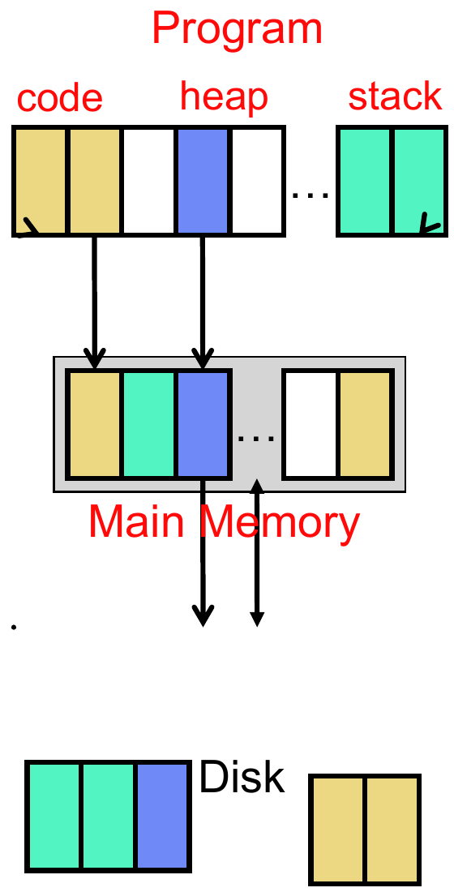
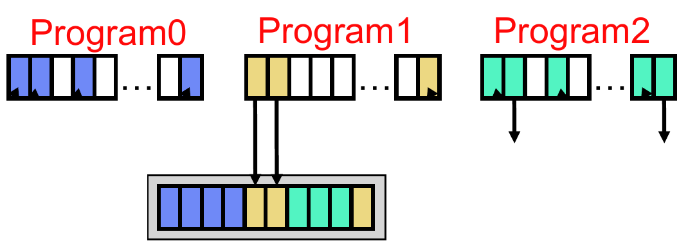
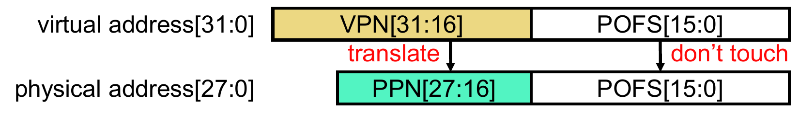
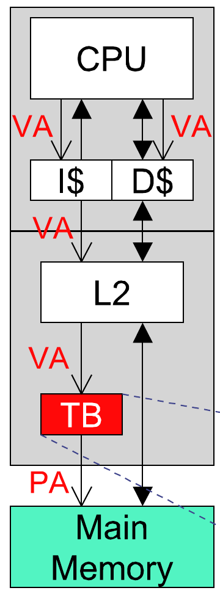
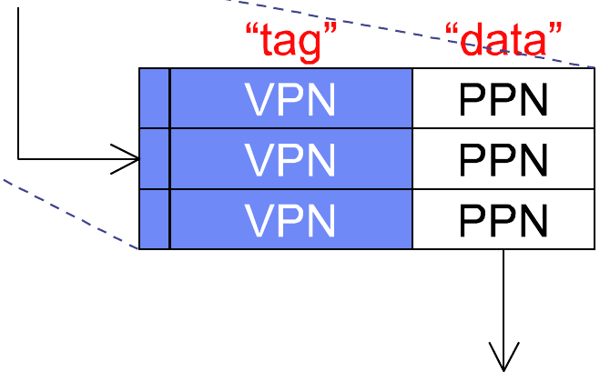
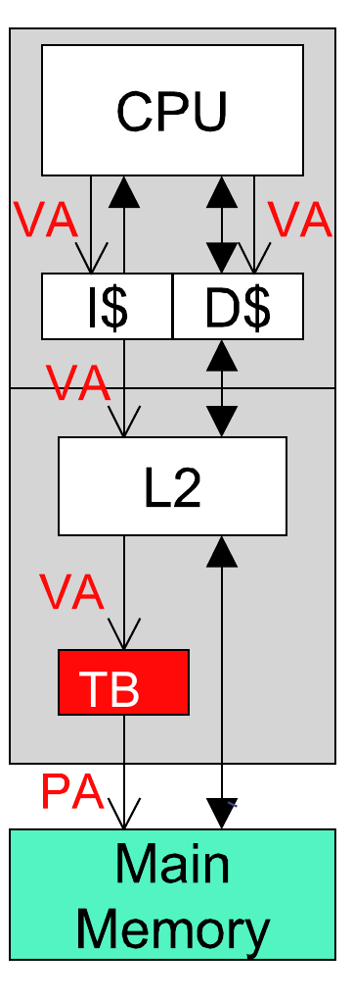
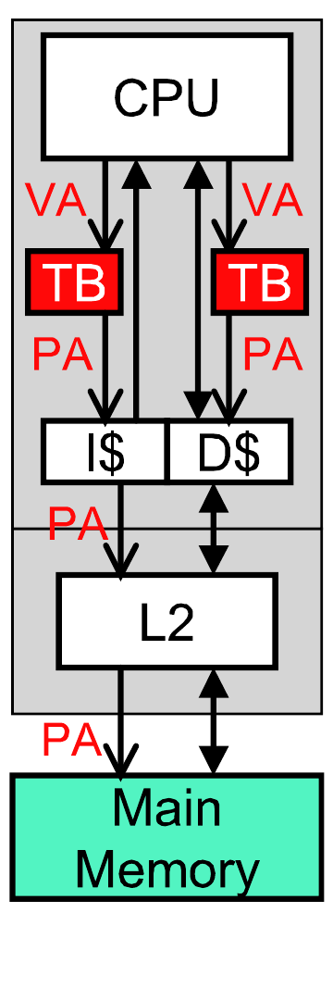
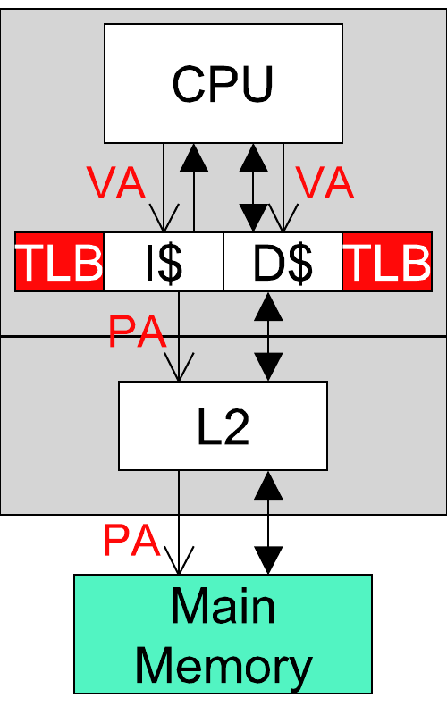
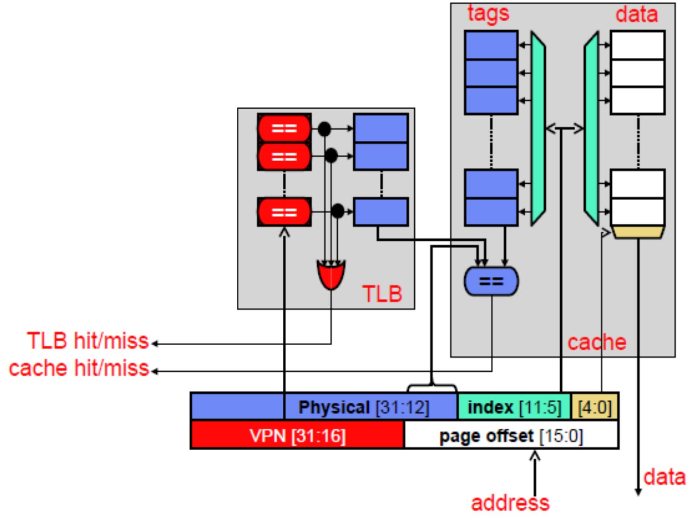

# Virtual Memory

The basic idea behind virtual memory is to treat memory like a cache for the disk.

Programs use virtual addresses (varying from 0 to $2^n - 1$), which is also referred to as machine size. Memory uses physical addresses (varying from 0 to $2^m - 1$, where m < n); $2^m$ is the most physical memory machines support.

$\text{VA} \implies \text{PA}$ at page granularity. The mapping need not perserve contiguity, and virutal pages need not be mapped to any physical page, as unmapped pages live on the disk.



Each process has its own virtual address space. Mapping different processes' virtual pages to different physical pages provides isolation; mapping them to the same physical page allows shared memory.



## Address Translation

$\text{VA} \implies \text{PA}$ is called address translation. We can split VA into virtual page number (VPN) and page offset (POFS). VPN can be translated into physical page number (PPN). POFS is not translated.

For a 32-bit machine with 64KB pages, we have a 32-bit VA, 16-bit POFS, and a 16 bit VPN.



```
VA[31:0]       VPN[31:16] | POFS[15:0]
                     ↓          ↓
PA[27:0]       PPN[27:16] | POFS[15:0]
```

Addresses are translated with software, but have added hardware acceleration.

Each process is allocated a page table (PT), which maps VPs to PPs or disk addresses. It is stored in physical memory and contains page table entries (PTE), which can point to locations in physical memory or the swap disk. PTs are indexed by VPN.

We have six questions on the mechanics:
1. What: Translate addresses.
2. Why: Compatability, multiprogramming.
3. How: Page tables.
4. Where: Physical Memory
5. Who performs it?
6. When?

One option is that the process translates its own address. The page table resides in process-visible VA space. This is a bad idea, however, because it implies that the program must know about physical addresses and can forge them.

Another option is for the operating system to translate for processes. Page tables reside in OS VA space, which means user-level processes can't view or modify their own tables and don't need to know about physical addresses. We translate on L2 misses in this instance.

On an L2 miss, an interrupt transfers control to the OS handler, which translates the VA by accessing process page tables, accesses memory using the PA, and returns control when the L2 fill is complete.

## Page Table Size

> How big is a page table on a 32-bit machine with 4KB pages and 4B page table entries?

A 32-bit machine has a 32-bit VA and thus $2^{32} =$ 4 GB of virtual memory.

4GB VM / 4KB page size = 1 million VPs. 1M VPs * 4B PTE = 4MB.

## Making Address Translation Fast

Recall that PTs are in physical memory. We have two transactions involved, one to translate the address, and another to access the page if its in physical memory. This is slow, which we can fix buy using cache translations, or a translation buffer (TB). The idea is that we only walk a PT on a TB miss, otherwise accessing the TB.

### Translation Buffer

The TB is a small associative cache (16-64 entries) that exploits temporal locality in PT accesses. The OS handler is only invoked on a TB miss.





On a miss, we walk the PT. If the PTE describes a resident page, we load its translation into the TB. If the page is not resident, a page fault transfers control to the OS to fetch the page and update the PT. Then, we restart the instruction. There are two methods to handle a TB miss.

One is an OS routine, where we have short routines that walk the page table and update the TB. This keeps PT formats flexible, but adds latency through an OS call.

Another is a hardware FSM, where the PT register indexes PTs and we can walk them. This saves latency but requires a hard-coded PT format.

## Virtual-physical caches

### Virtual Caches

Virtual caches are **virtually indexed and virtually tagged (VIVT)**. The cache uses the VA for both set selection and tag comparison; translation to a PA is only needed when accessing physical memory.



* Fast on a cache hit because translation is outside the hit path.
* On a context switch, the same VA may refer to a different PA in the new process. Flush the caches or include a process identifier (PID) in cache tags to distinguish address spaces.
* **Aliasing** occurs when multiple VAs map to the same PA, as with shared memory. Separate cached copies can become inconsistent. Without a mechanism to keep them synchronized, shared memory must be left uncached, which is slow.

### Physical Caches

Physical caches are **physically indexed and physically tagged (PIPT)**. Translate the VA first, then use the PA to select a cache set and compare tags.



* Cache contents need not be flushed just because the process changes: tags identify physical locations.
* Shared memory uses the same physical address and therefore the same cache entry, avoiding duplicate copies caused by virtual aliases within a cache.
* Translation is on the common-case critical path, increasing cache hit time $t_\text{hit}$.

### Virtual-Physical Caches: A Compromise

**Virtually indexed, physically tagged (VIPT)** caches use the VA to select a set and the PA to check its tag. Cache access and address translation proceed in parallel.



A translation buffer used alongside a cache is called a **translation lookaside buffer (TLB)**. Physical tags distinguish address spaces and identify shared physical memory. With the index constraint below, virtual aliases select the same set, avoiding the aliasing problem. Parallel lookup can hide translation latency without adding cache-hit cycles.

### Parallel TLB and Cache Access

The same VA is interpreted in two ways:

* Cache lookup: tag, set index, and block offset.
* TLB lookup: VPN and page offset.



The cache can read a set while the TLB translates the VPN, then compare the resulting physical tag with the tags read from that set. This works when translation does not change the cache index: **the index and VPN must not overlap**. All index and block-offset bits must lie within the unchanged page offset.

In the slide example, 64 KiB pages give a page offset of `[15:0]`. A 32 B cache block uses offset bits `[4:0]`, and the cache index uses `[11:5]`, so set selection can proceed before translation completes. The physical tag uses bits `[31:12]`.

For cache capacity $C$, associativity $A$, and page size $P$, this constraint is:

$$\frac{C}{A} \leq P$$

That is, the cache capacity per way must not exceed the page size for this simple parallel organization.

### TLB Organization

TLBs have capacity, block size, and associativity choices like caches.

* High associativity reduces translation conflicts; the slides describe at least 4-way associativity, with fully associative organizations common.
* A TLB block size of two means that two consecutive virtual pages share one tag; the entry must provide their translations.
* A second-level TLB can serve misses in the first-level TLB before a page-table walk is needed.

### Forms of Virtual Memory

Virtual memory is widely used in general-purpose processors. Translation blocks can take several forms:

* **Paging (flat memory)**: equal-sized pages; the usual organization discussed in these notes.
* **Segmentation**: variable-sized translation regions; supported by IA-32 and more complex to manage.
* **Paged segments**: combine segmentation with paging.
