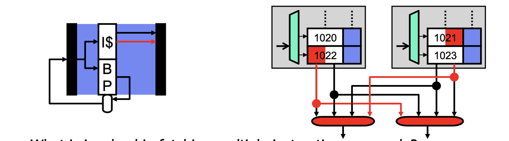

# Superscalar

## Scalar Pipelines and the Flynn Bottleneck

So far we have looked at **scalar pipelines**, where we have one instruction per stage with control speculation, bypassing. 

However, the performance limit is CPI = IPC = 1, or the Flynn bottleneck. This limit is never even achieved due to hazards, and we have limited returns from super-pipelining due to hazards and overhead.

One solution is to overcome this limit due to **multiple issue** or **superscalar** pipelines, where we can have more than one instruction per stage (typically 4-wide).

## Superscalar CPI Calculations

Base CPI of 1 for scalar pipelines. For N-way superscalar pipelines, base CPI is 1/N.

> Example: branch penalty calculation

20% branches, 75% taken, no explicit prediction, branch penalty of 2 cycles.

Scalar pipeline: $1 + 0.2*0.75*2 = 1.3 \rightarrow 1.3/1 \rightarrow 30\% \ \text{slowdown}$

2-way superscalar: $0.5 + 0.2*0.75*2 = 0.8 \rightarrow 0.8/0.5 = 1.6 \rightarrow 60\% \ \text{slowdown}$

4-way superscalar: $0.25 + 0.2*0.75*2 = 0.55 \rightarrow 0.55/0.25 = 2.2 \rightarrow 120\% \ \text{slowdown}$

## Superscalar Challenges

### Wide Fetch - Sequential Instructions



> What is involved in fetching multiple instructions per cycle?

If they're in the smae cache block there's no real issue. This favours large block sizes. Compileres align basic blocks to `I$` blocks, increasing fetch bandwidth utilization.

If they're in multiple blocks, we fetch them in parallel, which might add latency.

### Wide Non-Sequential Instruction Fetch

Two questions:

1. How many branches to predict per cycle?
2. What about instructions fetched across the branch if it is taken?

Most common organization is 1 and squash, which is one prediction where we discard post-branch instructions if taken. This lowers effective fetch width and IPC.

### Wide Decode

> What is involved in decoding multiple instructions per cycle?

For fixed length, decoding is easy. To read input registers we require $2N$ register read ports (latency $\alpha$ number of ports), but in practice it's less than $2N$ because most values come from bypasses.

What about the stall logic?

### N^2 Dependence Cross-Check

Stall logic for 1-wide pipeline with full bypassing:

* Load-use stalls: `X/M.op == LOAD && (D/X.rs1==X/M.rd || D/X.rs2==X/M.rd)`
* We have the WD stall as well.
* Two terms: $\alpha \ 2N$ (proportionality)

The same logic for a 2-wide pipeline:

```tex
X/M1.op == LOAD && (D/X1.rs1==X/M1.rd || D/X1.rs2==X/M1.rd) ||
X/M1.op == LOAD && (D/X2.rs1==X/M1.rd || D/X2.rs2==X/M1.rd) ||
X/M2.op == LOAD && (D/X1.rs1==X/M1.rd || D/X1.rs2==X/M1.rd) ||
X/M2.op == LOAD && (D/X2.rs1==X/M1.rd || D/X2.rs2==X/M1.rd)
```

* Eight terms: $\alpha \ 2N^2$
  * $N^2$ dependence cross-check
* Not quite done, also need: `D/X2.rs1==D/X1.rd || D/X2.rs2==D/X1.rd`

### Wide Execute

> What is involved in executing $N$ instructions per cycle?

Do we need $N$ execution units of every kind?

* $N$ ALUs? Maybe, ALUs are small.
* $N$ FP dividers? No, FP dividers are huge and `fdiv` is uncommon.
* Typically some mix of functional units proportional to instruction mix.

### Wide Bypass

* $N^2$ stall logic
  * Ok, only a small number of bits.
* $N^2$ bypass netword
  * $N+1$ input muxes at each ALU input
  * $N^2$ point-to-point connections
  * Routing lengthens wires
* $N^2$ bypass busses
  * 32/64-bit widths
  * Difficult to lay out and route
  * One of the big problems of superscalar

#### Clustering

Clustering offers a solution to $N^2$ bypass by grouping ALUs into $k$ clusters with full bypassing within clusters and limited or no bypassing between.

The key to performance is that hardware steers dependent instructions to the same cluster. This is typically used with replicated regfiles.

### Wide Memory Access

> What about multiple load/stores per cycle?

For 2-wide, this is usually not necessary. For 4-wide or greater, this sometimes occurs. However, it is more important to support multiple loads than multiple stores.

#### D$ Bandwidth: Multi-Porting, Replication

> How to provide additional D$ bandwidth?

We have already seen split `I$/D$` but that only gives one `D$` port. How can we provide a second or third `D$` port?

One option is multi-porting, which is the most general solution (any two accesses per cycle), but is the most expensive in terms of latency, area (cost) and power.

Another option is replication, where we add read bandwidth but writes must go to all replicas. This is a general solution for loads with no latency penalty but is not a solution for stores (which is ok) and incurs an area and power penalty.

### Wide Register R/W

> How many register file ports to execute $N$ instructions per cycle?

Nominally, $2N$ read + $N$ write (2 read + 1 write per instruction). In reality, fewer than that because many values come from bypasses, and stores and branches (approx. 35% of instructions) don't write registers.

## Mulitple-Issue Implementations

Superscalar

* Executes unmodified sequential programs, but hardware must figure out what can be done in parallel.

Very Long Instruction Word (VLIW)

* Hardware can be dumb and low power, but compiler must group parallel instructions which requires new binaries.

Explicitly Parallel Instruction Computing (EPIC)

* A compromise: compiler does some, hardware does the rest.

Dynamically-scheduled superscalar

* Pentium Pro/II/III (3-wide), Core-i7 series, etc.