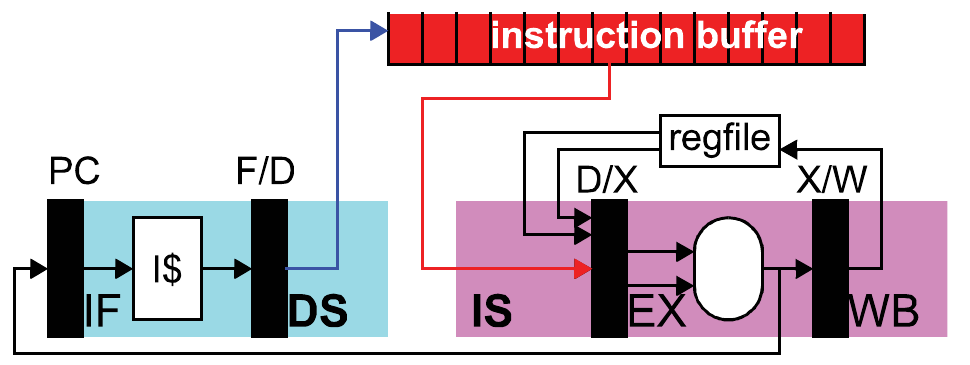
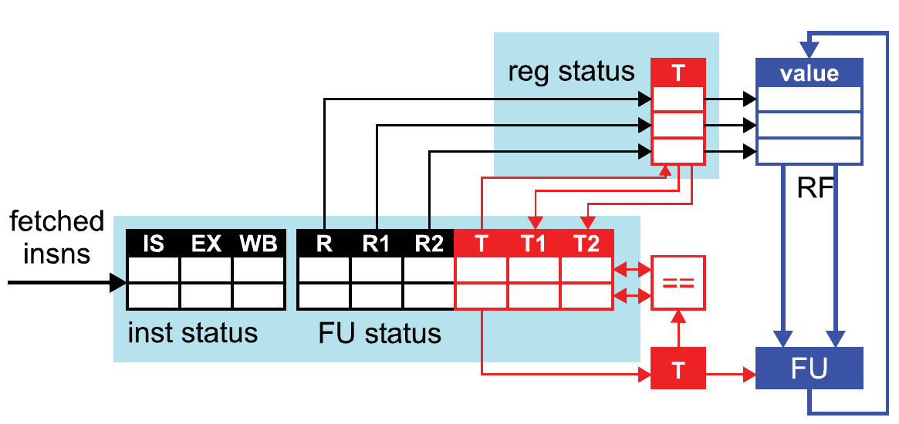
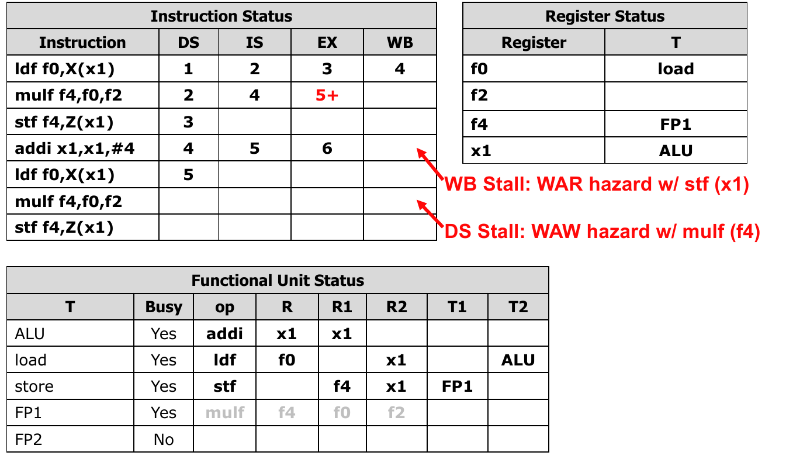
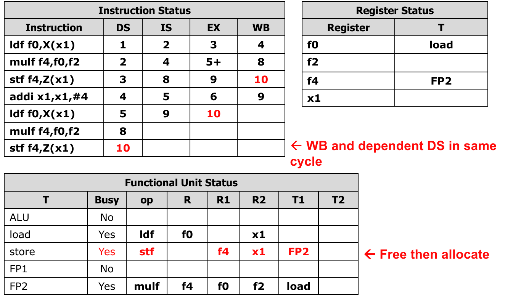
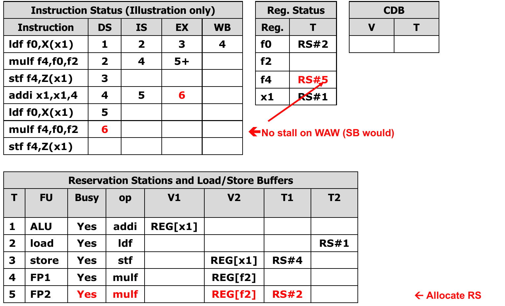
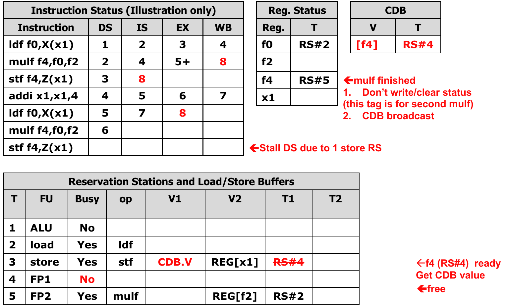
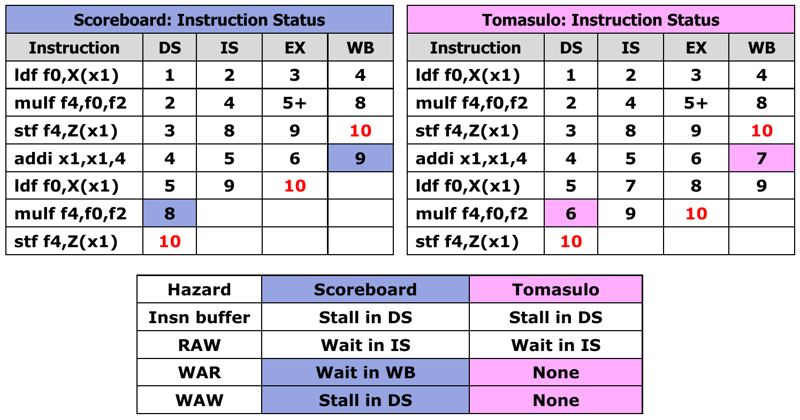

# Dynamic Scheduling

Our basic pipeline started with single, in-order issue, single-cycle operations. We extended this basic pipeline with multi-cycle operations and multiple issue (superscalar).

Now we have dynamic-scheduling (out-of-order execution), where we want to execute instructions in non-sequential order. This will reduce stalls, improve functional unit utilization, and enable parallel execution.

We want to make this all appear like sequential execution, which is extremely important but hard to get correct.

## Scheduling

Scheduling is the process of re-arranging instructions to maximize performance. This requires knowledge of the processor structure, latencies and dependencies.

Two options for who should schedule instructions: dynamic (hardware) or static (compiler).

## The Problem with In-Order Pipelines

In a simple in-order pipeline we may have four stages (where EX is multi-cycle and includes M). There is a structural hazard in that we have 1 pipeline register per stage, and thus 1 instruction per stage per cycle. Younger instructions can't pass older ones without 'killing' them.

In an out-of-order pipeline, we can implement passing functionality.

### Instruction Buffer

The trick is to implement an instruction buffer, which is basically a bunch of latches for holding instructions. This represents the scope of instructions the scheduler can see.

We effectively split the decode stage into two pieces, accumulate decoded instructions in the buffer **in-order**, and the buffer sends instructions down the pipeline **out-of-order**.

This first piece is called **Dispatch**, and the second piece is called **Issue**.



## Scoreboarding

In scoreboarding, we treat the instruction buffer as a scoreboard. This provides a centralized control scheme for instructions.

We require some data strcutres to implement this, which includes:

* **Instruction status**: one entry per "active" instruction, informs what stage an instruction is in.
* **Functional Unit (FU) status**: one entry per FU
  * `busy`: FU is busy
  * `op`: current operation
  * `R1,R2,R`: source and destination registers
  * `T1,T2`: tags of FUs producing source registers.
  * `T`: tag of FU producing destination register.
* **Register status**: one entry per architectural register
  * `T`: tag of FU (if any) that will write the register
* Tag fields interpreted as "ready bits"
  * `tag == 0`: register value is ready in register file
  * `tag != 0`: register value is not ready in register file



## New Pipeline

The structure now is `IF, DS, IS, EX, WB`.

* `DS` (dispatch) from fetch to the scoreboard
  * (structural hazard/WAW hazard) ? stall : allocate
* `IS` (issue) to the functional units
  * (RAW hazard) ? (stall) : (read registers, go directly to execute)
* `EX` (execute)
  * execute operation, notify scoreboard when done
* `WB` (writeback)
  * (WAR hazard) ? (stall) : (write register, free scoreboard entry)

Assume WB and RAW-dependent IS can take place in same cycle, and WB and structural-dependent DS can take place in same cycle.

### Scoreboard: Dispatch

Stall for WAW and structural hazards, but otherwise allocate a scoreboard entry, copy status for input registers, and set status for output registers.

### Scoreboard: Issue

Wait for RAW hazards (T1/T2 not empty) but otherwise read registers.

### Scoreboard: Writeback

Wait for WAR hazards, but otherwise writeback result, compare tags with waiting instructions, clear tag on match.

## Scoreboard Example: Scalar Alpha X (SAX)

SAX is a simplified Single-Precision Alpha x X + Y (SAXPY): $Z[i] = A \times X[i]$. Here `f2` holds $A$, `x1` is the byte offset, and `x2` holds $4N$.

```asm
loop:
    ldf  f0,X(x1)       // Read X[i]
    mulf f4,f0,f2       // A * X[i]
    stf  f4,Z(x1)       // Write Z[i]
    addi x1,x1,#4       // Advance by one 4-byte element
    bge  x2,x1,loop
```

Consider two iterations with the branch ignored: `ldf, mulf, stf, addi, ldf, mulf, stf`. Assume single-wide dispatch and five FUs: one ALU, one load, one store, and two 3-cycle pipelined FP units. Other operations take one EX cycle; there is no bypassing.

### Timing Through Cycle 10

The table records completed stages through cycle 10; `-` means the stage has not occurred yet. Fetch is omitted, as in the slides.

| Instruction | DS | IS | EX | WB |
| --- | --- | --- | --- | --- |
| First `ldf f0,X(x1)` | 1 | 2 | 3 | 4 |
| First `mulf f4,f0,f2` | 2 | 4 | 5-7 | 8 |
| First `stf f4,Z(x1)` | 3 | 8 | 9 | 10 |
| `addi x1,x1,#4` | 4 | 5 | 6 | 9 |
| Second `ldf f0,X(x1)` | 5 | 9 | 10 | - |
| Second `mulf f4,f0,f2` | 8 | - | - | - |
| Second `stf f4,Z(x1)` | 10 | - | - | - |

### Why Instructions Stall

* **RAW at issue:** the first multiply waits for `f0` until the load writes in cycle 4. The first store waits for `f4` until cycle 8. WB and dependent IS can occur in the same cycle.
* **WAW at dispatch:** the second multiply cannot dispatch in cycles 6-7 because the first multiply still owns destination `f4`, even though FP2 is free. It dispatches to FP2 in cycle 8.
* **WAR at writeback:** `addi` finishes EX in cycle 6 but must preserve the old `x1` for the first store, which has not read its operands yet. The store reads in cycle 8; `addi` writes in cycle 9. The second load waits for this new `x1` and issues in cycle 9.



* **Structural hazard at dispatch:** the second store stalls in cycle 9 because the store unit is busy. It dispatches in cycle 10, when the first store writes back and frees the unit.



The younger `addi` issues and executes before the older store, demonstrating out-of-order execution. Tags track which producer each instruction needs, while WAR protection keeps the store's old `x1` intact.

## Scoreboarding: Tradeoffs

Scoreboarding uses cheap centralized hardware to improve FU utilization. Its scheduling scope remains limited: WAW and structural hazards block in-order dispatch, WAR hazards delay writeback and dependent instructions, and RAW dependencies wait for results in the register file.

## Tomasulo's Algorithm

In Tomasulo's algorithm, the instruction buffer becomes reservation stations (RS), which creates a distributed control scheme. We introduce a common data bus (CDB) that broadcasts results to reservation stations, and register renaming that eliminates WAR/WAW hazards.

We require some data strcutres to implement this, which includes:

* **Reservation stations**
  * `busy,FU,op,R`: destination register name
  * `T1,T2`: source register tag (RS# that will produce the value).
  * `T`: destination register tag (RS# of this RS).
  * `V1,V2`: source register value.
* **Register status**: one entry per architectural register
  * `T`: tag (RS# that will write register)
* **CBD**: common data bus
  * broadcasts `<value, tag>` of completed instructions
* Tag interpreted as ready bits
  * `tag == 0`: value is ready somewhere
  * `tag != 0`: value is not ready, wait until CDB broadcasts

## Scoreboard vs. Tomasulo

> What about Tomasulo implements register renaming?

Values are copied to reservation stations (renamed), instruction holds correct input values in its own RS, using a new RS entry for the same destination registers.

### Tomasulo-Style Register Renaming

Architectural registers are used for **names**. **Locations** include values in the register file AND reservation stations. Values can (and do) exist in both; copies eliminate WAR hazards. This is called value-based or copy-based renaming.

Internally, tags are used to refer to locations. The register table translates names to tags (`tag == 0` means the value is in the register file, `tag != 0` means its in the RS# tag). The CDB broadcasts values with tags attached so instructions know what value to look at.

## Tomasulo Pipeline

The structure now is `IF, DS, IS, EX, WB`.

* `DS` (dispatch)
  * (available RS) ? (allocate RS, copy ready values, non-ready tags to RS) : (stall)
* `IS` (issue)
  * (operands ready) ? (execute) : (stall, monitor CDB)
* `EX` (execute)
  * execute operation
* `WB` (writeback)
  * (CDB available) ? (broadcast result, write regfile, free RS) : (stall)

Assume WB and RAW-dependent IS can go in the same cycle, and that WB and structural dependent IS can go in the same cycle.

### Tomasulo: Dispatch

Stall for structural hazards, but read ready register values into RS, read tags for non-ready register values into RS, rename (set status for) new result.

### Tomasulo: Issue

Wait for RAW hazards to be resolved, read register values from CDB.

### Tomasulo: Writeback

Wait for free CDB (potential structural hazard), broadcast the result (`<value, tag>`) on CDB, write result to register file and clear register status if the tag matches, compare with RS input tags; clear tag and copy value if the tags match.

## Tomasulo Example: SAX (Slides 50-60)

Use the same two SAX iterations as before, ignoring the branch. There are five reservation stations: `RS#1` (ALU), `RS#2` (load), `RS#3` (store), `RS#4` (FP1), and `RS#5` (FP2). FP operations take three EX cycles; other operations take one.

### Timing Through Cycle 10

`-` means the stage has not occurred yet; `10` for the second multiply is its first EX cycle.

| Instruction | DS | IS | EX | WB |
| --- | --- | --- | --- | --- |
| First `ldf f0,X(x1)` | 1 | 2 | 3 | 4 |
| First `mulf f4,f0,f2` | 2 | 4 | 5-7 | 8 |
| First `stf f4,Z(x1)` | 3 | 8 | 9 | 10 |
| `addi x1,x1,#4` | 4 | 5 | 6 | 7 |
| Second `ldf f0,X(x1)` | 5 | 7 | 8 | 9 |
| Second `mulf f4,f0,f2` | 6 | 9 | 10 | - |
| Second `stf f4,Z(x1)` | 10 | - | - | - |

### Renaming and CDB Updates

* **Cycles 1-4:** the first load maps `f0` to `RS#2`. The first multiply copies ready `f2` and waits on `RS#2`; the store copies the old `x1` and waits on `RS#4` for `f4`. The load broadcasts in cycle 4, allowing the multiply to issue that cycle.
* **Cycles 5-6: no WAW stall.** The second load waits on `RS#1` for the updated `x1`. The second multiply dispatches to `RS#5` in cycle 6, changing the mapping of `f4` from `RS#4` to `RS#5`. The first store still waits on `RS#4`, so it receives the correct older result.



* **Cycle 7: no WAR stall.** `addi` writes the new `x1` and broadcasts it to the second load, which issues immediately. The first store already holds a copy of the old `x1`, so it is unaffected. With scoreboarding, `addi` had to wait until cycle 9.
* **Cycle 8: conditional register write.** The first multiply broadcasts with tag `RS#4`, waking the first store. It does **not** write `f4` or clear its register status, since `f4` now maps to `RS#5`.



* **Cycles 9-10:** the second load broadcasts in cycle 9, allowing the second multiply to issue. The second store stalls at dispatch in cycles 7-9 because the only store RS is busy; it allocates that RS in cycle 10 when the first store completes.

### Scoreboard vs. Tomasulo



Renaming lets the second multiply dispatch two cycles earlier; copying operands lets `addi` write back two cycles earlier, advancing the second load. RAW dependencies and limited RS capacity still cause stalls.

## Dynamic Scheduling: Summary

Both schemes split decode into **in-order dispatch** and **out-of-order issue** to improve FU utilization. Scoreboarding stalls for WAR/WAW hazards; Tomasulo removes them with tagged producers and operand copies in reservation stations.

Tomasulo distributes hazard detection, but CDB tag matching requires many associative comparisons. CDB bandwidth and reservation-station capacity remain structural limits. Precise state and speculation are the next extensions.
