# Dynamic Scheduling

Our basic pipeline started with single, in-order issue, single-cycle operations. We extended this basic pipeline with multi-cycle operations and multiple issue (superscalar).

Now we have dynamic-scheduling (out-of-order execution), where we want to execute instructions in non-sequential order. This will reduce stalls, improve functional unit utilization, and enable parallel execution.

We want to make this all appear like sequential execution, which is extremely important but hard to get correct.

## Scheduling

Scheduling is the process of re-arranging instructions to maximize performance. This requires knowledge of the processor structure, latencies and dependencies.

Two options for who should schedule instructions: dynamic (hardware) or static (compiler).

## The Problem with In-Order Pipelines

In a simple in-order pipeline we may have four stages (where EX is multi-cycle and includes M). There is a structural hazard in that we have 1 pipeline register per stage, and thus 1 instruction per stage per cycle. Younger instructions can't pass older ones without 'killing' them.

In an out-of-order pipeline, we can implement passing functionality.

### Instruction Buffer

The trick is to implement an instruction buffer, which is basically a bunch of latches for holding instructions. This represents the scope of instructions the scheduler can see.

We effectively split the decode stage into two pieces, accumulate decoded instructions in the buffer **in-order**, and the buffer sends instructions down the pipeline **out-of-order**.

This first piece is called **Dispatch**, and the second piece is called **Issue**.

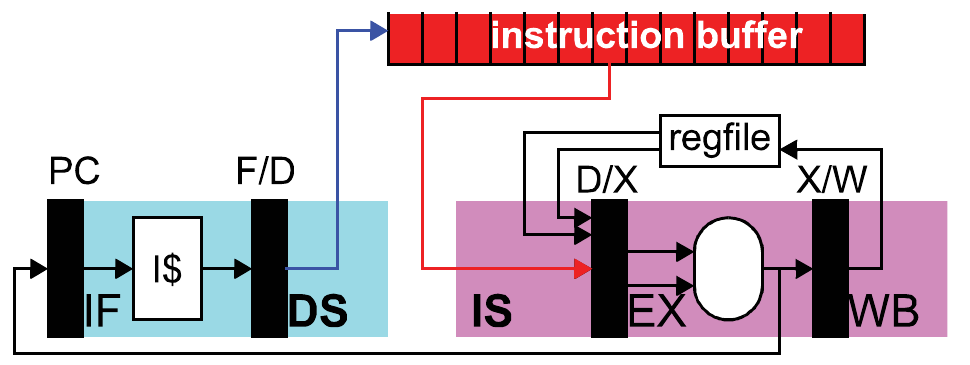

## Scoreboarding

In scoreboarding, we treat the instruction buffer as a scoreboard. This provides a centralized control scheme for instructions.

We require some data strcutres to implement this, which includes:

* **Instruction status**: one entry per "active" instruction, informs what stage an instruction is in.
* **Functional Unit (FU) status**: one entry per FU
  * `busy`: FU is busy
  * `op`: current operation
  * `R1,R2,R`: source and destination registers
  * `T1,T2`: tags of FUs producing source registers.
  * `T`: tag of FU producing destination register.
* **Register status**: one entry per architectural register
  * `T`: tag of FU (if any) that will write the register
* Tag fields interpreted as "ready bits"
  * `tag == 0`: register value is ready in register file
  * `tag != 0`: register value is not ready in register file

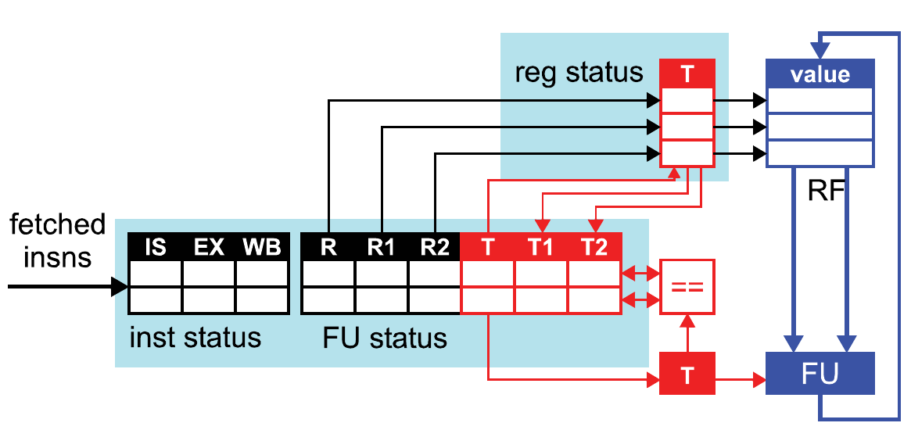

## New Pipeline

The structure now is `IF, DS, IS, EX, WB`.

* `DS` (dispatch) from fetch to the scoreboard
  * (structural hazard/WAW hazard) ? stall : allocate
* `IS` (issue) to the functional units
  * (RAW hazard) ? (stall) : (read registers, go directly to execute)
* `EX` (execute)
  * execute operation, notify scoreboard when done
* `WB` (writeback)
  * (WAR hazard) ? (stall) : (write register, free scoreboard entry)

Assume WB and RAW-dependent IS can take place in same cycle, and WB and structural-dependent DS can take place in same cycle.

### Scoreboard: Dispatch

Stall for WAW and structural hazards, but otherwise allocate a scoreboard entry, copy status for input registers, and set status for output registers.

### Scoreboard: Issue

Wait for RAW hazards (T1/T2 not empty) but otherwise read registers.

### Scoreboard: Writeback

Wait for WAR hazards, but otherwise writeback result, compare tags with waiting instructions, clear tag on match.

## Scoreboard Example: Scalar Alpha X (SAX)

SAX is a simplified Single-Precision Alpha x X + Y (SAXPY): $Z[i] = A \times X[i]$. Here `f2` holds $A$, `x1` is the byte offset, and `x2` holds $4N$.

```asm
loop:
    ldf  f0,X(x1)       // Read X[i]
    mulf f4,f0,f2       // A * X[i]
    stf  f4,Z(x1)       // Write Z[i]
    addi x1,x1,#4       // Advance by one 4-byte element
    bge  x2,x1,loop
```

Consider two iterations with the branch ignored: `ldf, mulf, stf, addi, ldf, mulf, stf`. Assume single-wide dispatch and five FUs: one ALU, one load, one store, and two 3-cycle pipelined FP units. Other operations take one EX cycle; there is no bypassing.

### Timing Through Cycle 10

The table records completed stages through cycle 10; `-` means the stage has not occurred yet. Fetch is omitted, as in the slides.

| Instruction | DS | IS | EX | WB |
| --- | --- | --- | --- | --- |
| First `ldf f0,X(x1)` | 1 | 2 | 3 | 4 |
| First `mulf f4,f0,f2` | 2 | 4 | 5-7 | 8 |
| First `stf f4,Z(x1)` | 3 | 8 | 9 | 10 |
| `addi x1,x1,#4` | 4 | 5 | 6 | 9 |
| Second `ldf f0,X(x1)` | 5 | 9 | 10 | - |
| Second `mulf f4,f0,f2` | 8 | - | - | - |
| Second `stf f4,Z(x1)` | 10 | - | - | - |

### Why Instructions Stall

* **RAW at issue:** the first multiply waits for `f0` until the load writes in cycle 4. The first store waits for `f4` until cycle 8. WB and dependent IS can occur in the same cycle.
* **WAW at dispatch:** the second multiply cannot dispatch in cycles 6-7 because the first multiply still owns destination `f4`, even though FP2 is free. It dispatches to FP2 in cycle 8.
* **WAR at writeback:** `addi` finishes EX in cycle 6 but must preserve the old `x1` for the first store, which has not read its operands yet. The store reads in cycle 8; `addi` writes in cycle 9. The second load waits for this new `x1` and issues in cycle 9.

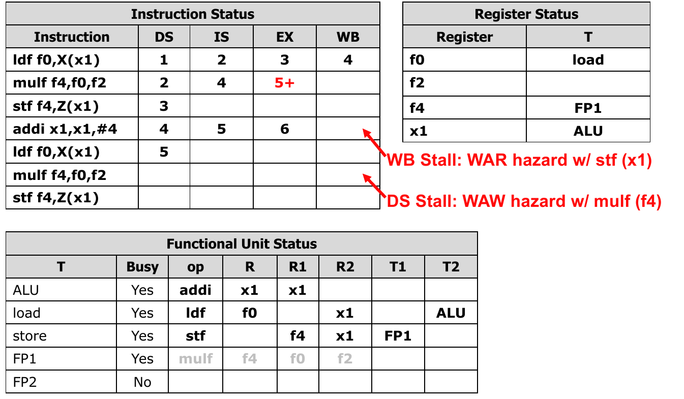

* **Structural hazard at dispatch:** the second store stalls in cycle 9 because the store unit is busy. It dispatches in cycle 10, when the first store writes back and frees the unit.

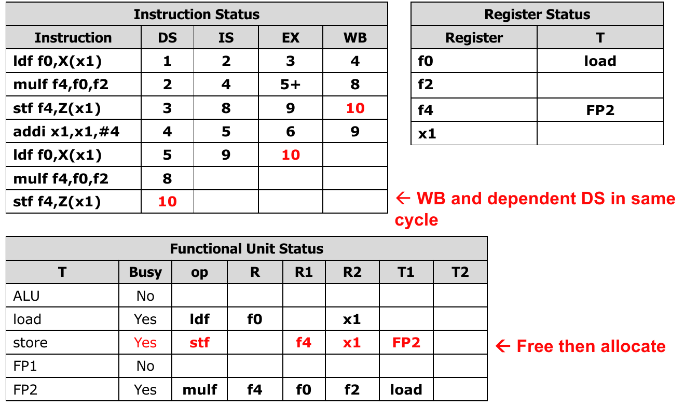

The younger `addi` issues and executes before the older store, demonstrating out-of-order execution. Tags track which producer each instruction needs, while WAR protection keeps the store's old `x1` intact.

## Scoreboarding: Tradeoffs

Scoreboarding uses cheap centralized hardware to improve FU utilization. Its scheduling scope remains limited: WAW and structural hazards block in-order dispatch, WAR hazards delay writeback and dependent instructions, and RAW dependencies wait for results in the register file.

## Tomasulo's Algorithm

In Tomasulo's algorithm, the instruction buffer becomes reservation stations (RS), which creates a distributed control scheme. We introduce a common data bus (CDB) that broadcasts results to reservation stations, and register renaming that eliminates WAR/WAW hazards.

We require some data strcutres to implement this, which includes:

* **Reservation stations**
  * `busy,FU,op,R`: destination register name
  * `T1,T2`: source register tag (RS# that will produce the value).
  * `T`: destination register tag (RS# of this RS).
  * `V1,V2`: source register value.
* **Register status**: one entry per architectural register
  * `T`: tag (RS# that will write register)
* **CBD**: common data bus
  * broadcasts `<value, tag>` of completed instructions
* Tag interpreted as ready bits
  * `tag == 0`: value is ready somewhere
  * `tag != 0`: value is not ready, wait until CDB broadcasts

## Scoreboard vs. Tomasulo

> What about Tomasulo implements register renaming?

Values are copied to reservation stations (renamed), instruction holds correct input values in its own RS, using a new RS entry for the same destination registers.

### Tomasulo-Style Register Renaming

Architectural registers are used for **names**. **Locations** include values in the register file AND reservation stations. Values can (and do) exist in both; copies eliminate WAR hazards. This is called value-based or copy-based renaming.

Internally, tags are used to refer to locations. The register table translates names to tags (`tag == 0` means the value is in the register file, `tag != 0` means its in the RS# tag). The CDB broadcasts values with tags attached so instructions know what value to look at.

## Tomasulo Pipeline

The structure now is `IF, DS, IS, EX, WB`.

* `DS` (dispatch)
  * (available RS) ? (allocate RS, copy ready values, non-ready tags to RS) : (stall)
* `IS` (issue)
  * (operands ready) ? (execute) : (stall, monitor CDB)
* `EX` (execute)
  * execute operation
* `WB` (writeback)
  * (CDB available) ? (broadcast result, write regfile, free RS) : (stall)

Assume WB and RAW-dependent IS can go in the same cycle, and that WB and structural dependent IS can go in the same cycle.

### Tomasulo: Dispatch

Stall for structural hazards, but read ready register values into RS, read tags for non-ready register values into RS, rename (set status for) new result.

### Tomasulo: Issue

Wait for RAW hazards to be resolved, read register values from CDB.

### Tomasulo: Writeback

Wait for free CDB (potential structural hazard), broadcast the result (`<value, tag>`) on CDB, write result to register file and clear register status if the tag matches, compare with RS input tags; clear tag and copy value if the tags match.

## Tomasulo Example: SAX (Slides 50-60)

Use the same two SAX iterations as before, ignoring the branch. There are five reservation stations: `RS#1` (ALU), `RS#2` (load), `RS#3` (store), `RS#4` (FP1), and `RS#5` (FP2). FP operations take three EX cycles; other operations take one.

### Timing Through Cycle 10

`-` means the stage has not occurred yet; `10` for the second multiply is its first EX cycle.

| Instruction | DS | IS | EX | WB |
| --- | --- | --- | --- | --- |
| First `ldf f0,X(x1)` | 1 | 2 | 3 | 4 |
| First `mulf f4,f0,f2` | 2 | 4 | 5-7 | 8 |
| First `stf f4,Z(x1)` | 3 | 8 | 9 | 10 |
| `addi x1,x1,#4` | 4 | 5 | 6 | 7 |
| Second `ldf f0,X(x1)` | 5 | 7 | 8 | 9 |
| Second `mulf f4,f0,f2` | 6 | 9 | 10 | - |
| Second `stf f4,Z(x1)` | 10 | - | - | - |

### Renaming and CDB Updates

* **Cycles 1-4:** the first load maps `f0` to `RS#2`. The first multiply copies ready `f2` and waits on `RS#2`; the store copies the old `x1` and waits on `RS#4` for `f4`. The load broadcasts in cycle 4, allowing the multiply to issue that cycle.
* **Cycles 5-6: no WAW stall.** The second load waits on `RS#1` for the updated `x1`. The second multiply dispatches to `RS#5` in cycle 6, changing the mapping of `f4` from `RS#4` to `RS#5`. The first store still waits on `RS#4`, so it receives the correct older result.

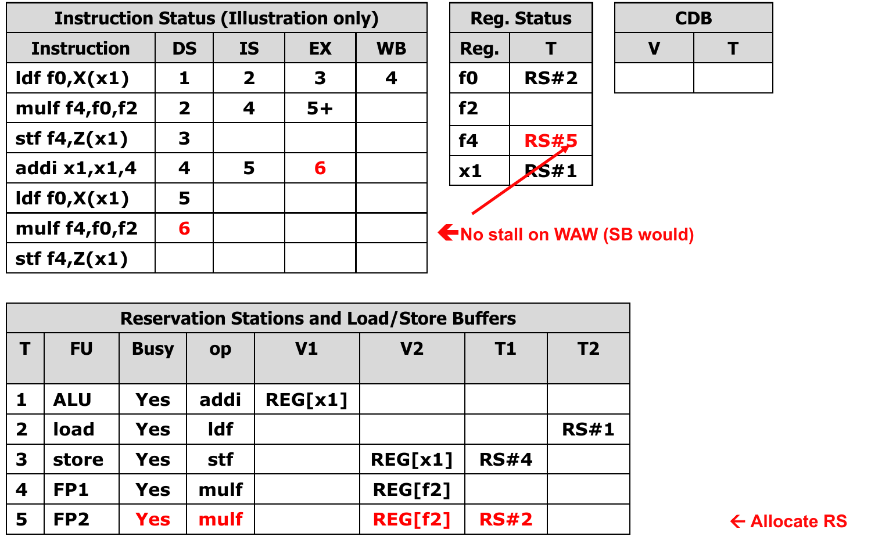

* **Cycle 7: no WAR stall.** `addi` writes the new `x1` and broadcasts it to the second load, which issues immediately. The first store already holds a copy of the old `x1`, so it is unaffected. With scoreboarding, `addi` had to wait until cycle 9.
* **Cycle 8: conditional register write.** The first multiply broadcasts with tag `RS#4`, waking the first store. It does **not** write `f4` or clear its register status, since `f4` now maps to `RS#5`.

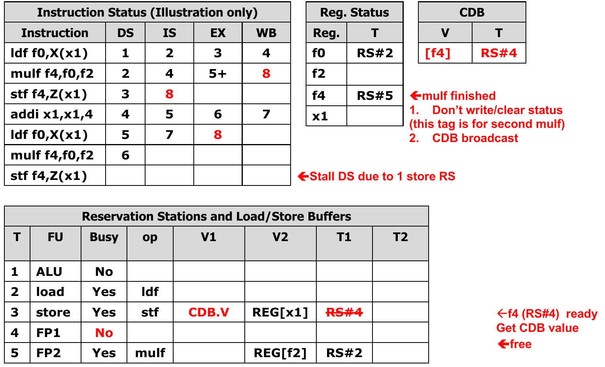

* **Cycles 9-10:** the second load broadcasts in cycle 9, allowing the second multiply to issue. The second store stalls at dispatch in cycles 7-9 because the only store RS is busy; it allocates that RS in cycle 10 when the first store completes.

### Scoreboard vs. Tomasulo

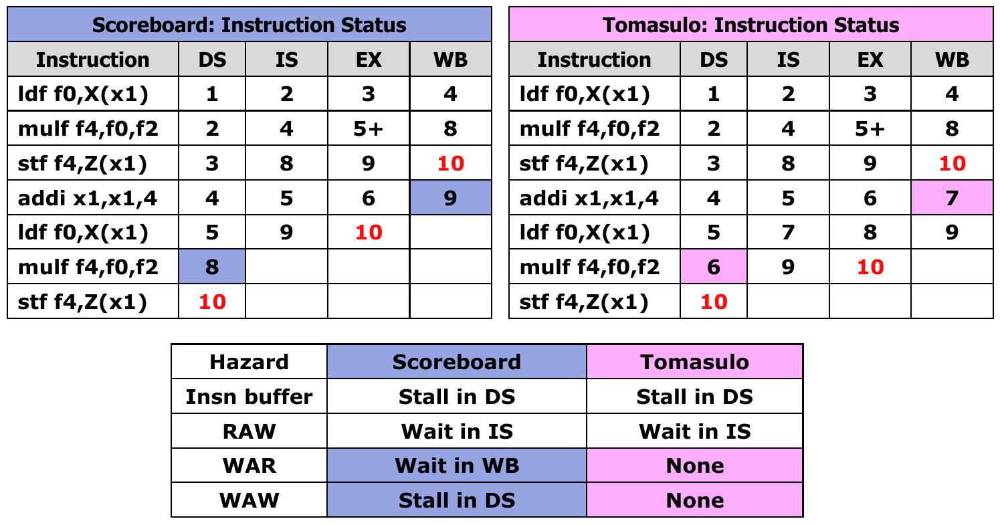

Renaming lets the second multiply dispatch two cycles earlier; copying operands lets `addi` write back two cycles earlier, advancing the second load. RAW dependencies and limited RS capacity still cause stalls.

## Dynamic Scheduling: Summary

Both schemes split decode into **in-order dispatch** and **out-of-order issue** to improve FU utilization. Scoreboarding stalls for WAR/WAW hazards; Tomasulo removes them with tagged producers and operand copies in reservation stations.

Tomasulo distributes hazard detection, but CDB tag matching requires many associative comparisons. CDB bandwidth and reservation-station capacity remain structural limits. Precise state and speculation are the next extensions.

## Superscalar, OoO, Speculation

Superscalar pipelines, out-of-order execution and branch speculation are three concepts that work well when used together.

If we have a CPI >= 1, we can overcome it with superscalar pipelines. If superscalar increases hazards, we can overcome it with dynamic scheduling. If RAW dependencies are still a problem, we can overcome it with a large instruction window. If we have an issue filling a large window because of branches, we can overcome it with speculation.

## Speculation and Precise Interrupts

> Why are we discussing these together?

Sequential semantics for interrupts dictate that all instructions before an interrupt should be complete, and all instructions after should look as if they never started. We want the same thing for a mis-predicted branch.

Precise interrupts are hard because out-of-order completion means you must undo post-interrupt writebacks.

> With out-of-order pipe, precise interrupts and mis-speculation recovery are the same problem.

They have the same solution: implementing the ability to abort and restart at every instruction. This is called **precise state**.

## The Problem with Precise State

The problem is in the writeback stage (WB). It mixes two things together that should be separate:

* Broadcasts values to RS, ok to be out-of-order.
* Writes value to registers, should be in-order.

The solution is to split writeback into two stages.

## Reorder Buffer (ROB)

The instruction buffer now becomes the reorder buffer (ROB), and WB is split into two stages: Complete (CM) and Retire (RT).

* CM: completed result values written to ROB out-of-order.
* RT: Retire (also called commit or graduate) updates the architectural register file or commits a store to `D$`, in program order. An incomplete instruction at the ROB head blocks younger instructions from retiring.

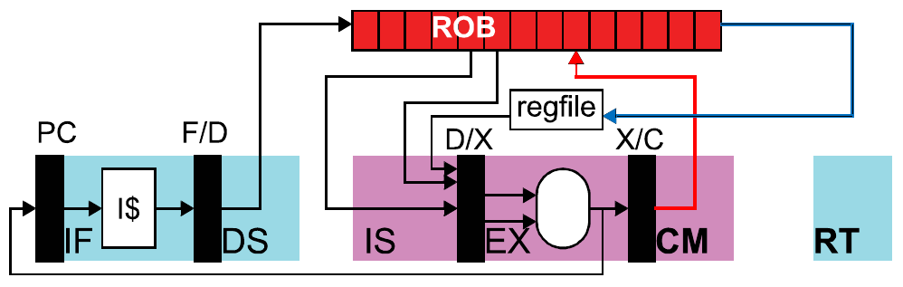

## Memory Ordering Buffer (MOB)

Completed stores keep their address and data in the MOB until retirement. When a store retires, its entry at the head of the store queue writes to `D$`. A load can check the MOB and `D$` in parallel. If an older buffered store matches the load address, the load forwards from the youngest such store once its data is ready.

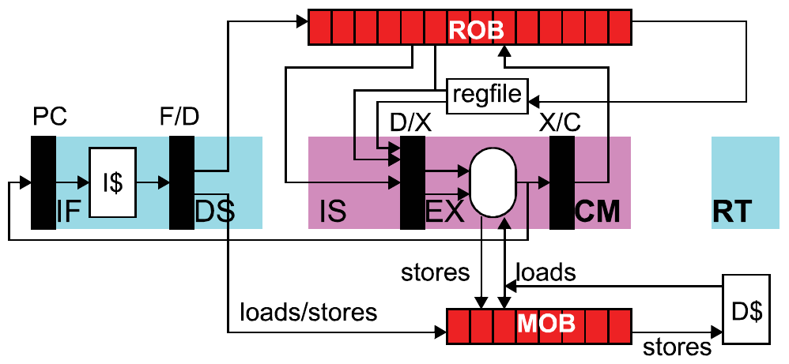

## Tomasulo with a ROB: P6 Style

The lecture's simplified Pentium Pro (P6) model keeps the **ROB and reservation stations separate**. The RS hold instructions waiting to execute; the ROB holds instructions in program order until retirement. The example uses one ALU station, one load station, one store station, and two FP stations with three-cycle FP execution.

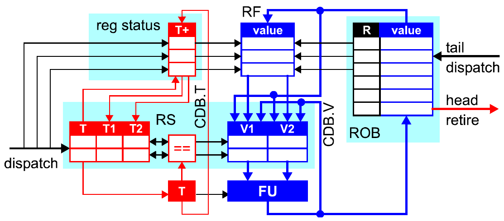

* The ROB tail allocates entries in order; the head identifies the oldest unretired instruction. An entry records its destination register `R`, result `V`, and whether it is complete.
* A producer tag is now a **ROB entry number**, so the result can still be identified after its reservation station has been freed.
* The register status table records the latest producer tag and a **ready-in-ROB** bit. `0` means read the architectural register file; a nonzero tag without `+` means wait for that producer; a tag with `+` means read its result from the ROB.

### P6 Pipeline

The stages are `IF → DS → IS → EX → CM → RT`.

1. **Dispatch (DS):** Stall if a needed RS, ROB, or MOB entry is unavailable. Otherwise allocate entries, assign the ROB number as the RS output tag, and map the destination to that tag with its ready bit clear.

   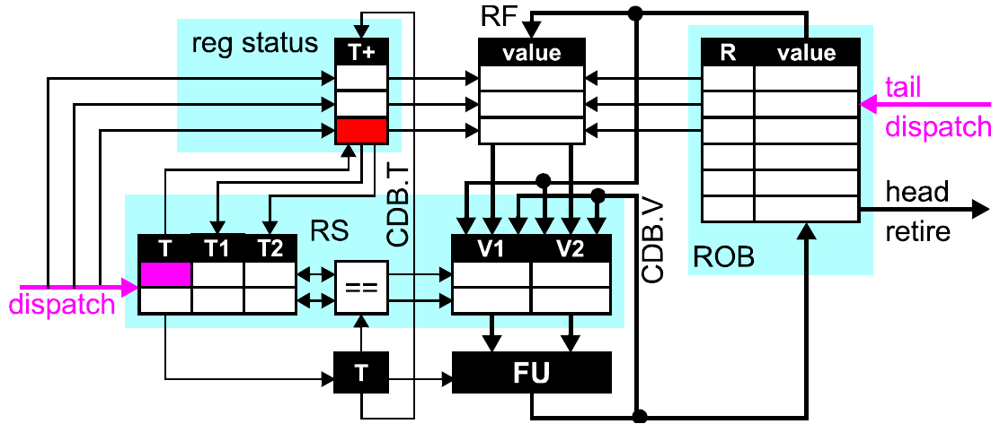

   Read each source using the mapping that preceded the destination update. Copy the value from the register file or ROB if ready; otherwise copy the producer tag into the RS.

   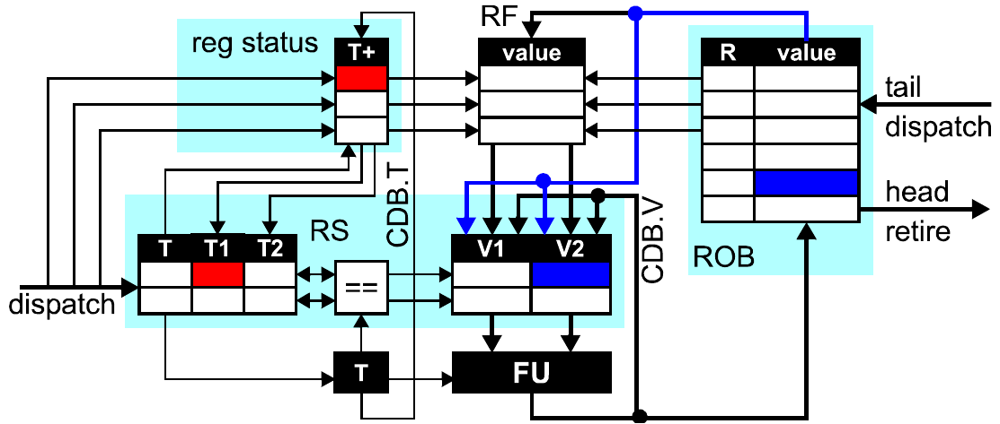

2. **Issue (IS):** An instruction can issue when its operands and functional unit are ready. Waiting operands monitor the common data bus (CDB) for a matching tag.
3. **Execute (EX):** The functional unit executes the operation. The RS can be freed when the unit takes over the instruction; the ROB tag keeps the producer identifiable through completion.
4. **Complete (CM):** Wait for the CDB if necessary, then broadcast `<value, tag>`, fill the tagged ROB entry, and mark it complete. Matching reservation stations capture the value. Set the destination's ready-in-ROB bit only if its current mapping still matches the completing tag.

   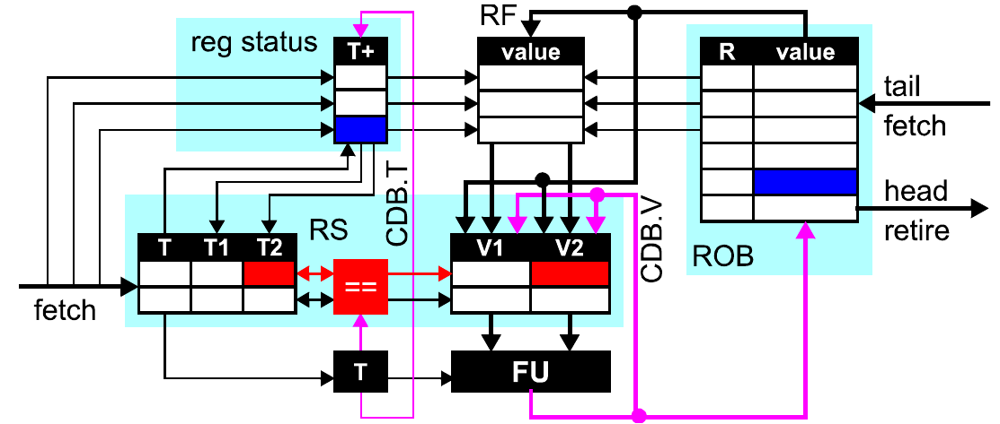

5. **Retire (RT):** Wait for the ROB head to complete and check for exceptions before making its effects visible. A register result goes to the architectural register file, and a store commits from the MOB to `D$`. Clear the register's status only if it still names the retiring producer. Free the ROB entry and any corresponding MOB entry.

   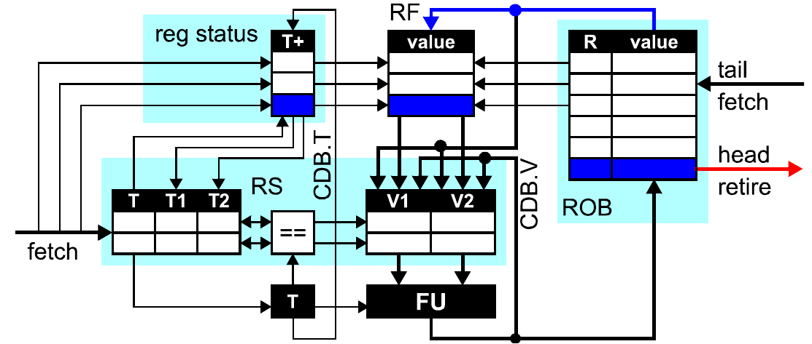

### P6 Example: SAX Through Cycle 11

Use the same two SAX iterations as before. The slides call the byte-offset register `r1`; it is `x1` in the earlier example. `ROB#1` through `ROB#7` identify the instructions in program order. The MOB tracks the load and store addresses alongside the ROB in the diagrams.

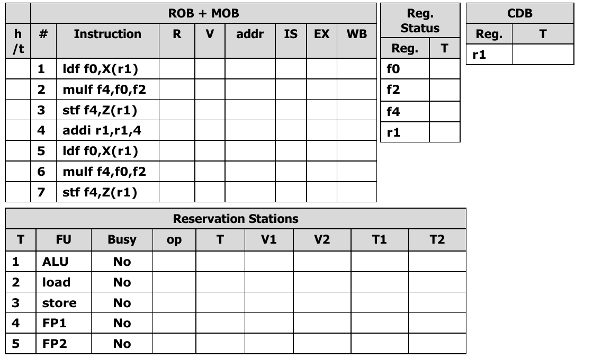

| ROB | Instruction | DS | IS | EX through cycle 11 | CM | RT |
| --- | --- | --- | --- | --- | --- | --- |
| 1 | First `ldf` | 1 | 2 | 3 | 4 | 5 |
| 2 | First `mulf` | 2 | 4 | 5-7 | 8 | 9 |
| 3 | First `stf` | 3 | 8 | 9 | 10 | 11 |
| 4 | `addi` | 4 | 5 | 6 | 7 | - |
| 5 | Second `ldf` | 5 | 7 | 8 | 9 | - |
| 6 | Second `mulf` | 6 | 9 | 10-11 (still executing) | - | - |
| 7 | Second `stf` | 9 | - | - | - | - |

`-` means the stage has not happened by the end of cycle 11. The table follows the normal execution path; the precise-state example below changes what happens at cycle 11.

* **Cycles 1-3:** Dispatch the first load, multiply, and store. The multiply waits on `ROB#1` for `f0`; the store waits on `ROB#2` for `f4` and already has the old `r1`. The first load issues in cycle 2 and executes in cycle 3, freeing its RS.
* **Cycle 4:** The load completes and broadcasts `f0`, waking the first multiply for issue. `addi` dispatches to `ROB#4`.

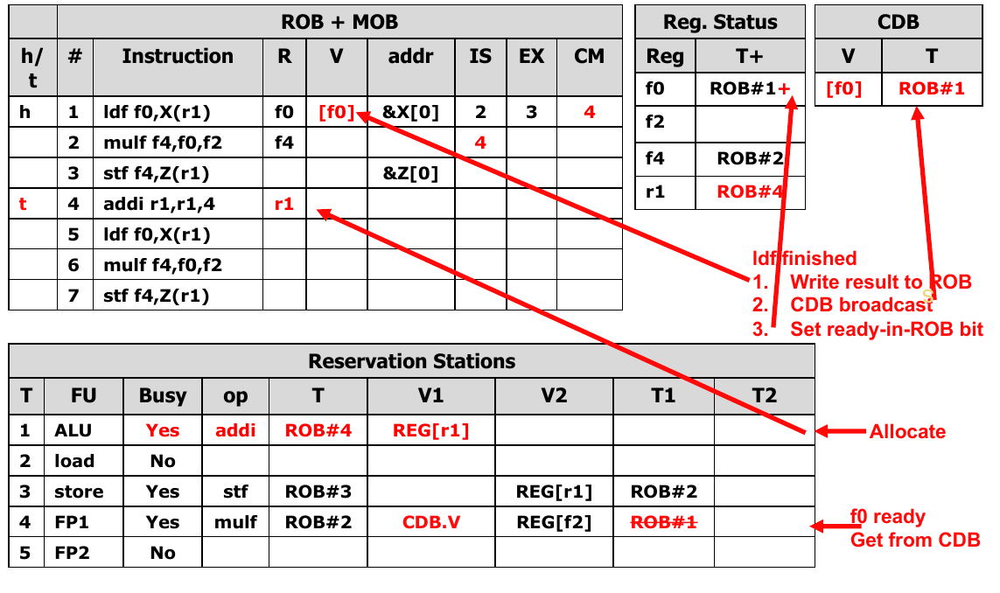

* **Cycles 5-6:** The first load retires. The second load dispatches and waits for `ROB#4` to produce the new `r1`. The second multiply dispatches and remaps `f4` to `ROB#6`; the first store keeps waiting on `ROB#2` for the older value.

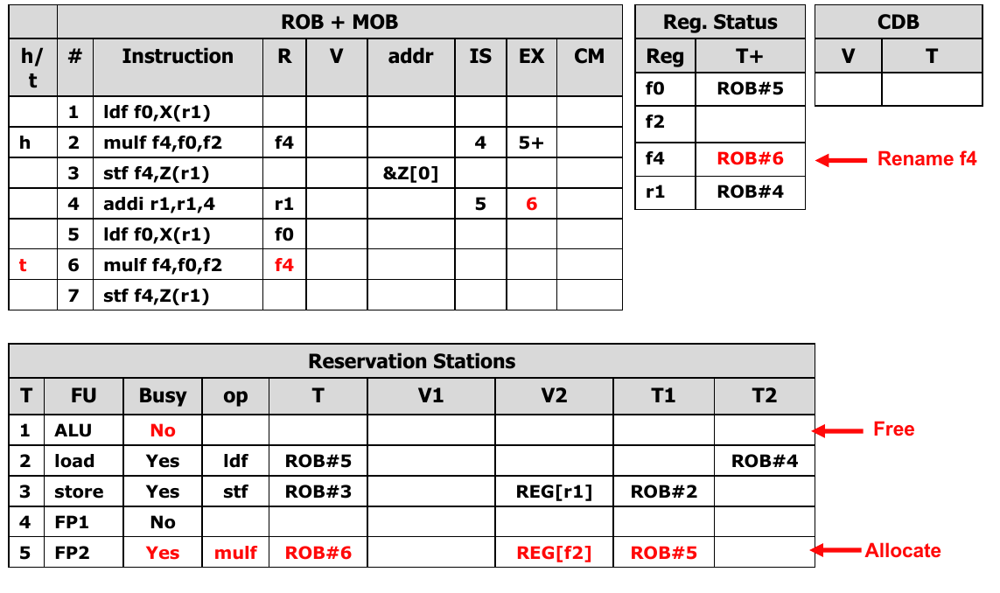

* **Cycles 7-8:** `addi` completes in cycle 7, waking the second load. The first multiply completes in cycle 8, waking the first store without changing the newer `f4` mapping. The second store cannot dispatch in either cycle because the store RS is busy.
* **Cycle 9:** The first multiply retires. The second load completes and wakes the second multiply. The first store executes and frees its RS, so the second store can dispatch. It takes `r1` from the completed but unretired `ROB#4` and waits on `ROB#6` for `f4`.

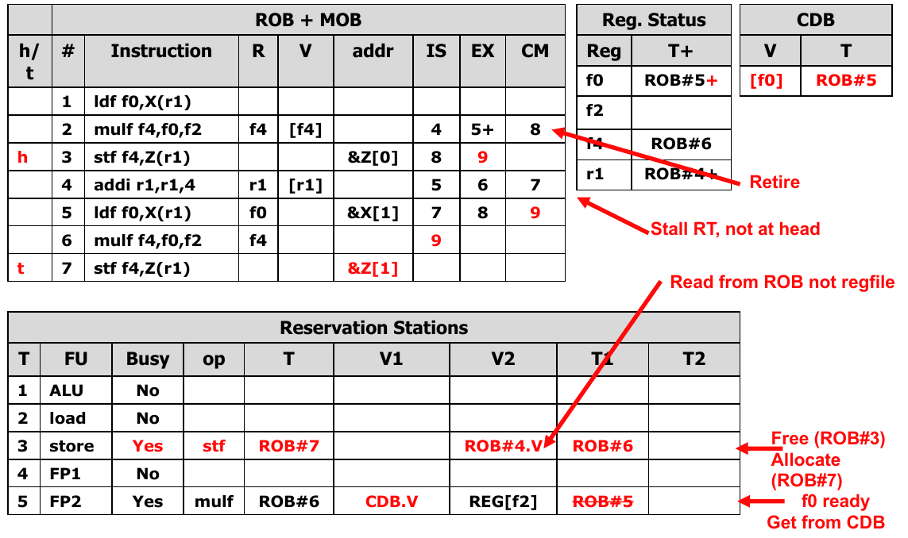

* **Cycles 10-11:** The first store completes in cycle 10 and retires in cycle 11 on the normal path. The younger `addi` and second load are already complete, but neither can retire ahead of that store.

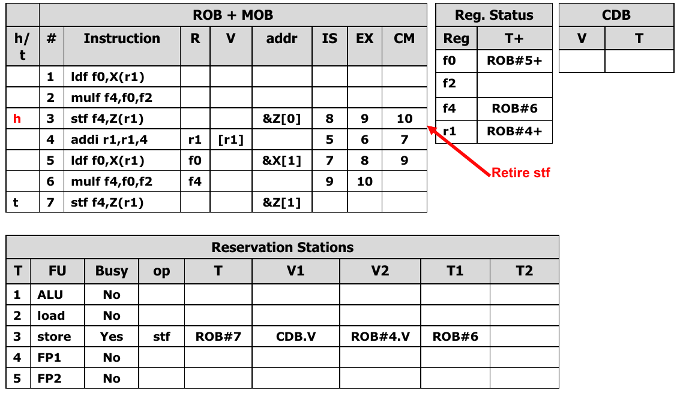

## Precise State with the ROB

An exception may be detected before retirement, but it is handled when its instruction reaches the ROB head. At that point, all older instructions have committed. The faulting instruction and younger instructions have not updated the architectural register file or committed their stores. In the lecture's recovery scheme, discard their ROB, RS, and MOB entries and clear the register status table. An empty status entry now points back to the committed register file. Once the handler has resolved a restartable fault, resume from the faulting instruction.

### Restarting the SAX Store

* **Cycle 11:** Suppose the first `stf` reaches retirement with an exception. Its store must not update `D$`. The younger `addi` and second load have completed only into the ROB.

  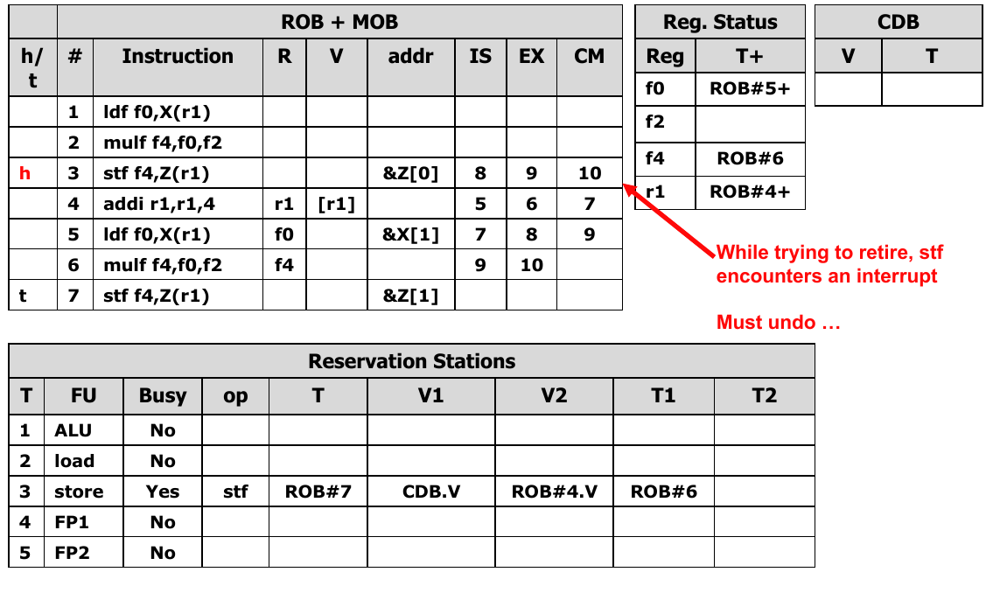

* **Cycle 12:** Flush the faulting store and all younger work, including the buffered stores and register mappings. The first load and multiply have already retired, so their values remain available.

  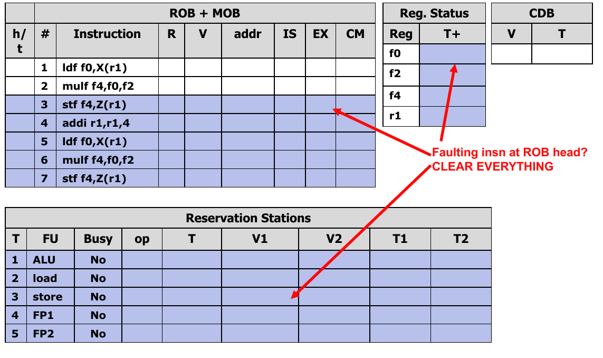

* **Cycles 13-14:** The example resumes at the first store in cycle 13. It reads committed `f4` and the old `r1` from the register file. It issues in cycle 14 as `addi` dispatches again. The cycle numbers illustrate the restart sequence without modeling the handler's latency.

  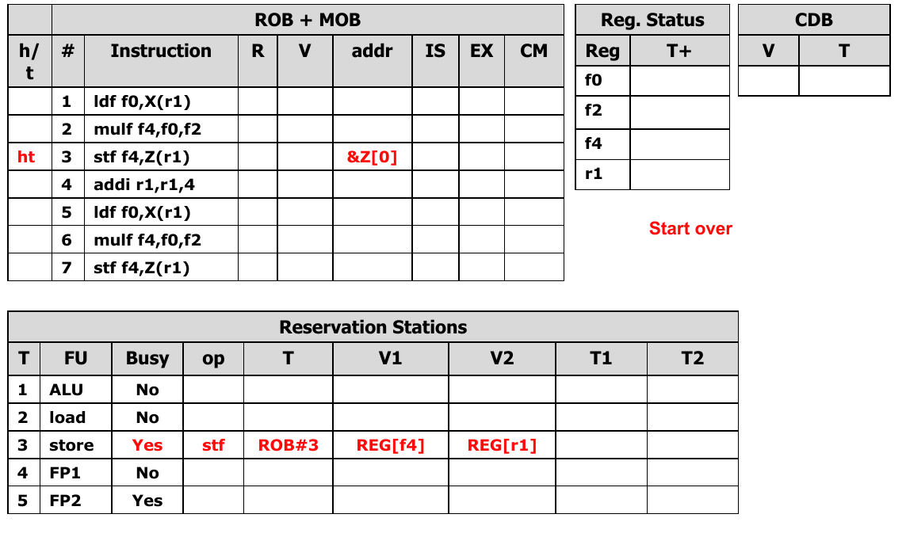

  The slide still marks FP2 busy at restart, but the flush in cycle 12 cleared the second multiply; its FP2 reservation does not survive recovery.

## P6 Performance and Organization

The example has similar execution timing to regular Tomasulo, with an extra in-order retirement stage. Keeping unretired values separate makes recovery straightforward. The slides cite Pentium Pro, PowerPC, and AMD K6 as examples of this style.

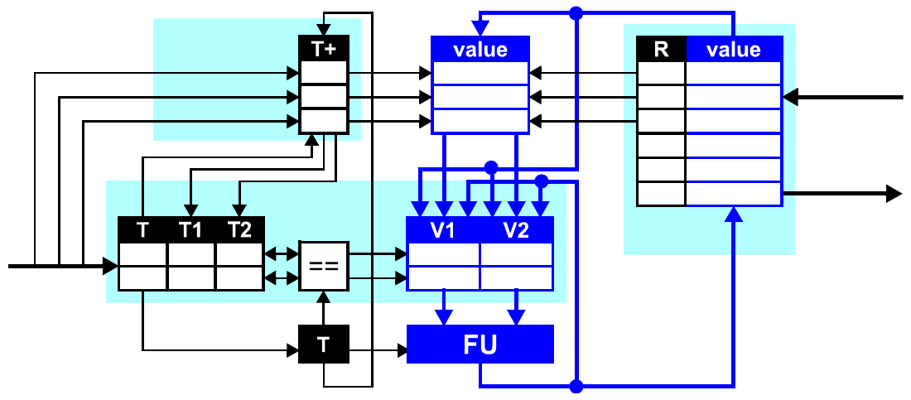

The cost is moving values from the register file or ROB to the RS and from the ROB back to the register file. Several possible operand sources require buses and multiplexers, and placing full values beside tags in the RS makes the data paths longer.

## MIPS R10K: Physical Register Renaming

The R10K-style organization separates control from data. The ROB and reservation stations track instruction order, operand tags, and readiness. One **physical register file (PRF)**, placed close to the functional units, holds both committed and speculative register values. Results stay in their assigned physical registers rather than being copied through the ROB or into a separate architectural register file at retirement.

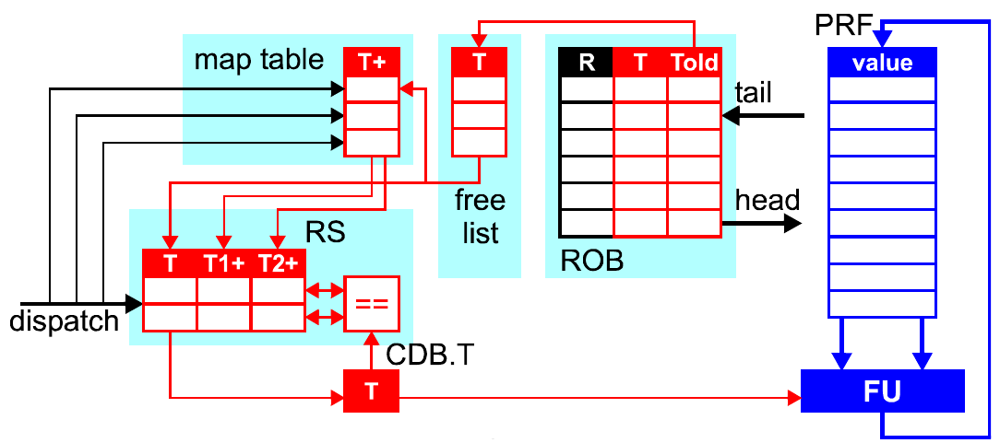

* There are more physical registers than architectural registers. The **register map table** maps each architectural name to a physical register. Unlike P6, there is no special zero mapping meaning “read the architectural register file.”
* Each destination gets a fresh physical register from the **free list**. Source operands keep the physical tags they were assigned. WAR and WAW hazards disappear because different versions of the same architectural register occupy different locations; RAW dependencies still wait for the producer.
* The ROB records the new and old physical tags for each destination. When the overwriting instruction retires, its old physical register can return to the free list. Retirement does not copy the result value.

### R10K Pipeline

The stages remain `IF, DS, IS, EX, CM, RT`, but operands and results now stay in the PRF.

* **Dispatch (DS):** Stall if a required RS, ROB, or MOB entry is unavailable, or if an instruction needs a destination register and the free list is empty. Capture source mappings, allocate a new physical destination, save the previous mapping as `Told` in the ROB, and update the map table. Stores have no register destination and need no new physical register.
* **Issue (IS):** Wait for source tags to be ready and the functional unit to be available, then read operands from the PRF.
* **Execute (EX):** Execute the operation and free the RS once it is no longer needed. The physical destination tag stays with the executing instruction.
* **Complete (CM):** Write the result to the destination physical register, broadcast its tag to wake dependent instructions, and mark the ROB entry complete. The scheduling CDB carries tags; values travel on the FU-to-PRF path.
* **Retire (RT):** Wait for the ROB head to complete and check for exceptions. Commit a store from the MOB if needed, free ROB/MOB entries, and return the previous physical destination `Told` to the free list. Keep the new physical destination allocated.

Retirement makes a result architecturally committed without moving its bits. An old physical register cannot be freed when its replacement merely dispatches or completes: older instructions may still need its value, and recovery may need its mapping.

### R10K Data Structures

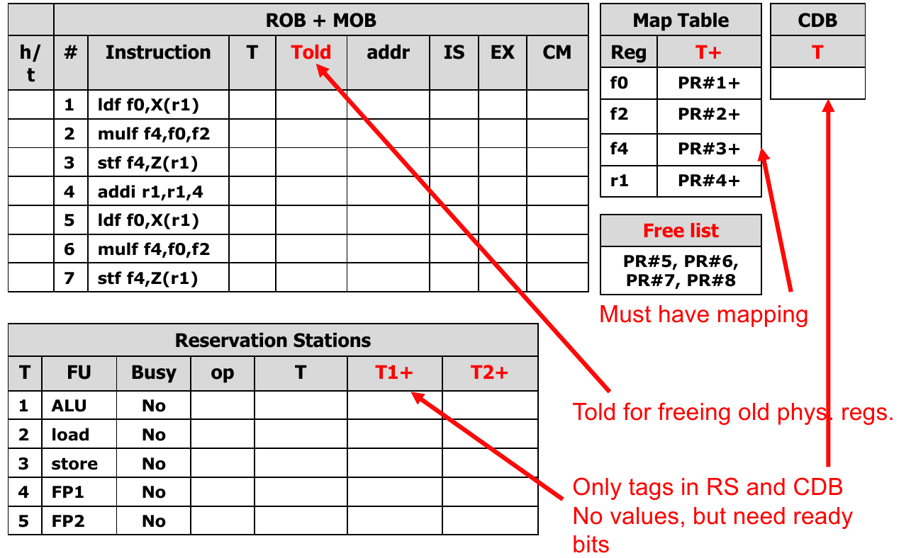

* **ROB:** instruction order, new destination `T`, old destination `Told`, completion status, and associated memory information.
* **Map table:** the latest physical tag for every architectural register, plus readiness. A `+` means the physical register contains a ready value; mappings are never zero.
* **RS:** operation, destination tag, and source tags with ready bits. Operand values are read at issue rather than copied into the RS.
* **Free list:** physical registers available for new destinations. Allocation removes a register; retirement or rollback can return one.

### R10K Example: SAX

Use the same instructions, functional units, and latencies as the P6 example. Initially `f0`, `f2`, `f4`, and `r1` map to ready `PR#1`, `PR#2`, `PR#3`, and `PR#4`. The free list contains `PR#5` through `PR#8`.

| Instruction | New destination `T` | Previous destination `Told` | Source tags |
| --- | --- | --- | --- |
| First `ldf f0,X(r1)` | `PR#5` | `PR#1` | `r1`: `PR#4` |
| First `mulf f4,f0,f2` | `PR#6` | `PR#3` | `PR#5`, `PR#2` |
| First `stf f4,Z(r1)` | None | None | `PR#6`, `PR#4` |
| `addi r1,r1,4` | `PR#7` | `PR#4` | `PR#4` |
| Second `ldf f0,X(r1)` | `PR#8` | `PR#5` | `r1`: `PR#7` |
| Second `mulf f4,f0,f2` | `PR#1` (reused) | `PR#6` | `PR#8`, `PR#2` |
| Second `stf f4,Z(r1)` | None | None | `PR#1`, `PR#7` |

The issue, execute, and completion cycles are the same as the P6 SAX example. The important difference is where results live and how physical registers are reclaimed.

* **Cycles 1-3:** The first load and multiply allocate `PR#5` and `PR#6`. The store keeps source tags `PR#6` and `PR#4`, so it will use the first multiply's result and the old loop offset even after the map table changes. The load issues in cycle 2 and executes in cycle 3.
* **Cycle 4:** The load writes `PR#5` and broadcasts that tag. The first multiply becomes ready and issues. `addi` allocates `PR#7` while retaining `PR#4` as its source and old destination.

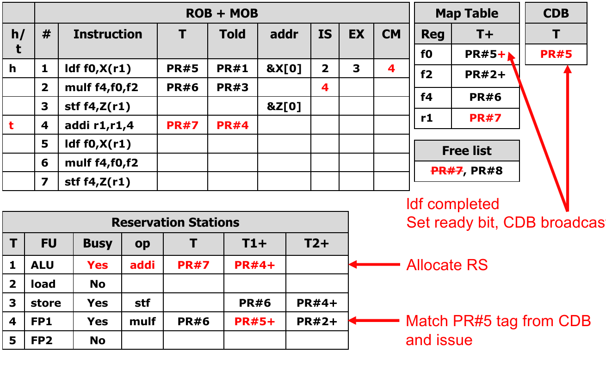

* **Cycle 5:** The first load retires and returns its old destination `PR#1` to the free list. The second load allocates `PR#8` and waits on `PR#7` for the updated offset. The current `f0` mapping becomes `PR#8`; the first multiply still reads `PR#5`.
* **Cycle 6:** The second multiply reuses the freed `PR#1` as its destination and saves `PR#6` as `Told`. Two versions of `f4` coexist without a WAW stall. `addi` executes, while the second load still waits for its result.

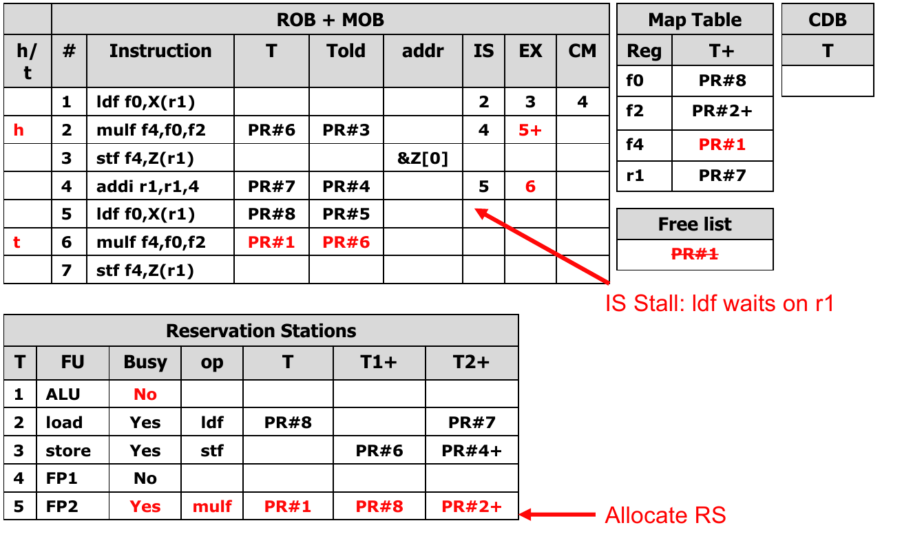

* **Cycles 7-8:** `addi` completes into `PR#7`, allowing the second load to issue in cycle 7. The first multiply completes into `PR#6` in cycle 8, waking the first store. The second store stalls at dispatch because the store RS is busy. `addi` cannot retire ahead of the older instructions.
* **Cycle 9:** The first multiply retires and frees `PR#3`, its old destination. The second load completes into `PR#8`, waking the second multiply. The first store executes and frees its RS, allowing the second store to dispatch with source tags `PR#1` and ready `PR#7`.

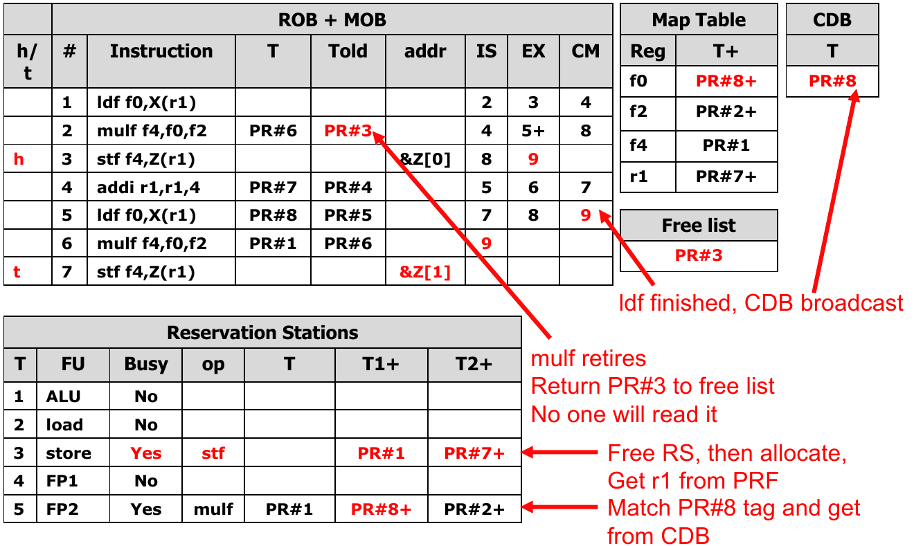

* **Cycle 10:** The first store completes into the MOB. Younger completed instructions still wait behind it at retirement. The second multiply begins execution in cycle 10.
* **Cycle 11:** The deck takes the exception path: the first store encounters an interrupt at retirement and does not commit. Recovery must undo the younger mappings before restarting it.

Some slide annotations retain free-list entries with strike-throughs to show allocation history. Those registers are no longer free. Likewise, the cycle 9 annotation saying to get a value from the CDB should be read in the R10K model as tag wakeup followed by a PRF read; the scheduling CDB carries no operand values.

### Precise Recovery with Physical Registers

Clearing the map table is insufficient: there is no separate architectural register file to fall back on. Restore the mappings to the committed values instead. The example **walks the ROB backward from the youngest instruction**, returning each new physical destination to the free list and restoring the architectural destination's mapping to `Told`. Discard the associated RS and MOB entries as well. Older committed values remain in the PRF throughout.

| Recovery cycle | Instruction undone | Register returned to free list | Mapping restored |
| --- | --- | --- | --- |
| 11 | Second store, `ROB#7` | None | None |
| 12 | Second multiply, `ROB#6` | `PR#1` | `f4 → PR#6` |
| 13 | Second load, `ROB#5` | `PR#8` | `f0 → PR#5` |
| 14 | `addi`, `ROB#4` | `PR#7` | `r1 → PR#4` |
| 15 | Faulting first store, `ROB#3` | None | None; restart the store after handling the condition |

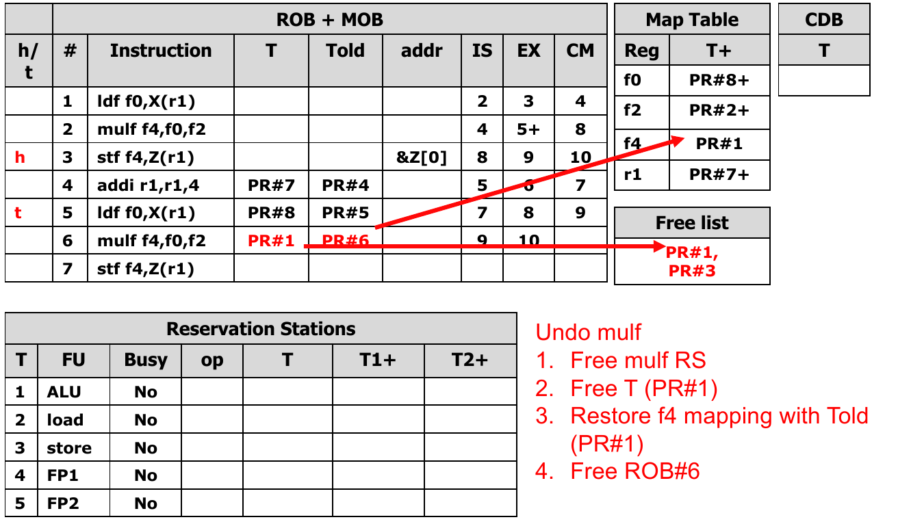

The cycle 12 slide incorrectly labels the restored `f4` mapping as `PR#1`; the saved `Told` is **`PR#6`**. This is the first multiply's committed result.

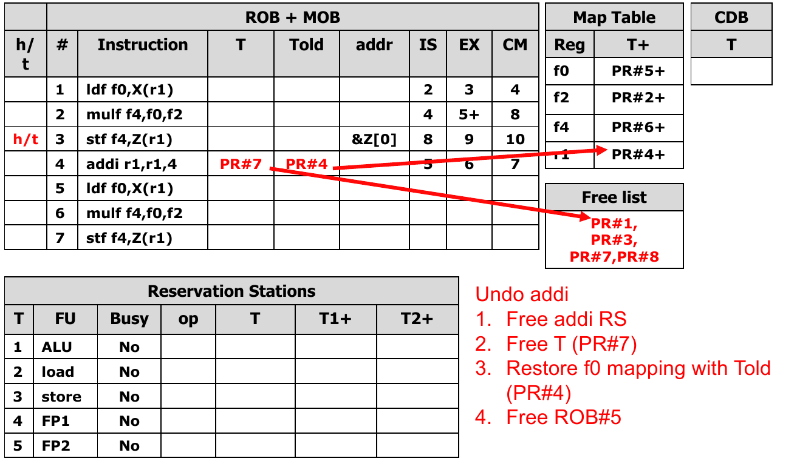

The cycle 14 annotation also has two typos: undoing `addi` restores **`r1`**, not `f0`, and frees **`ROB#4`**, not `ROB#5`.

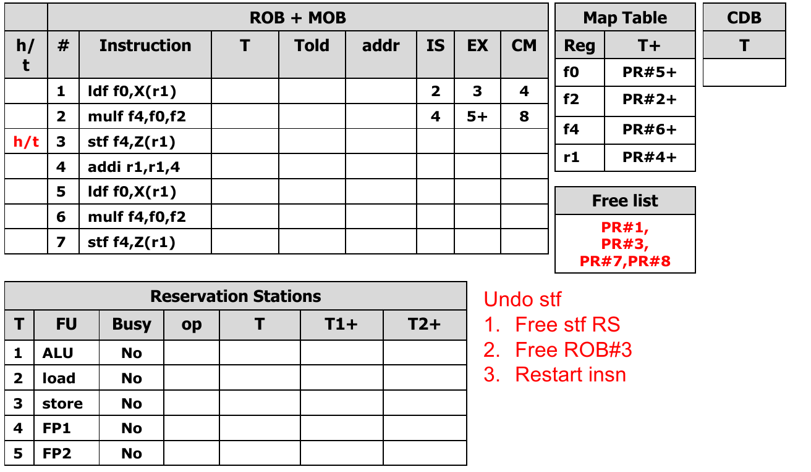

After rollback, the ready mappings are `f0 → PR#5`, `f2 → PR#2`, `f4 → PR#6`, and `r1 → PR#4`. The free registers are `PR#1`, `PR#3`, `PR#7`, and `PR#8`. Recovery takes several cycles in this example; a checkpoint of the map and allocation state is another way to restore a known boundary.

### P6 vs. R10K

| Feature | P6 style | R10K style |
| --- | --- | --- |
| Value storage | Architectural register file, ROB, and RS copies | Physical register file |
| Operand read | At DS, from register file or ROB into RS | At IS, from PRF to FU |
| Result write | CM fills ROB; RT copies result to register file | CM writes destination PRF entry; RT does not move the value |
| Reclaiming value storage | Retired result leaves the ROB | When an overwriting instruction retires, free its saved old physical destination |
| Main value paths | RF/ROB to RS, RS to FU, FU to ROB, ROB to RF | PRF to FU and FU to PRF |
| Recovery | Flush speculative buffers and register status | Restore mappings and reclaim speculative physical registers through rollback or checkpoints |

Both organizations preserve program order at retirement while allowing out-of-order execution and completion. P6 simplifies recovery by keeping committed values in a separate register file; R10K reduces value copying and keeps scheduling structures focused on tags.

## Dynamic Load Scheduling with the MOB

Register tags capture register dependencies, but they do not tell a load whether an older store will write its memory address. The MOB must enforce these **memory dependencies** and support store-to-load forwarding.

Treat **MOB + `D$`** as a memory functional unit: its inputs are an address and store data (`data_in`), and its output is load data (`data_out`). MOB entries record program order, load/store type, address, and data when available.

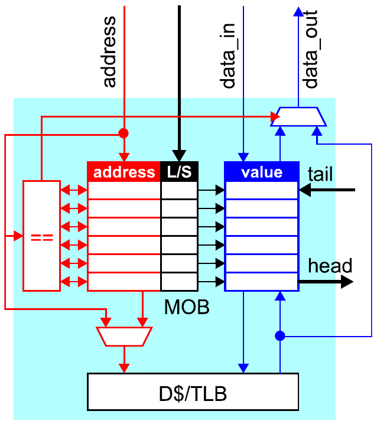

### Load/Store Dispatch

Allocate an entry at the MOB tail in program order, mark it as a load or store, and save its MOB number in the instruction's RS. The entry reserves its place before its address or data is necessarily ready.

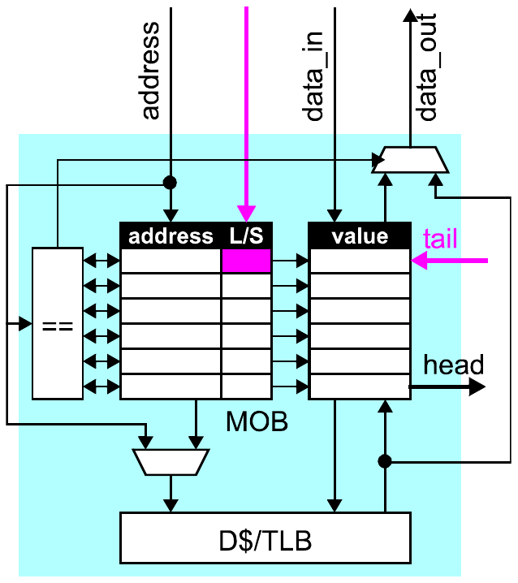

### Store Execution

When its operands are ready, send the store's address and value to its allocated MOB entry. This completes the speculative store's computation without writing `D$`. Younger loads can now forward from it if they require that value.

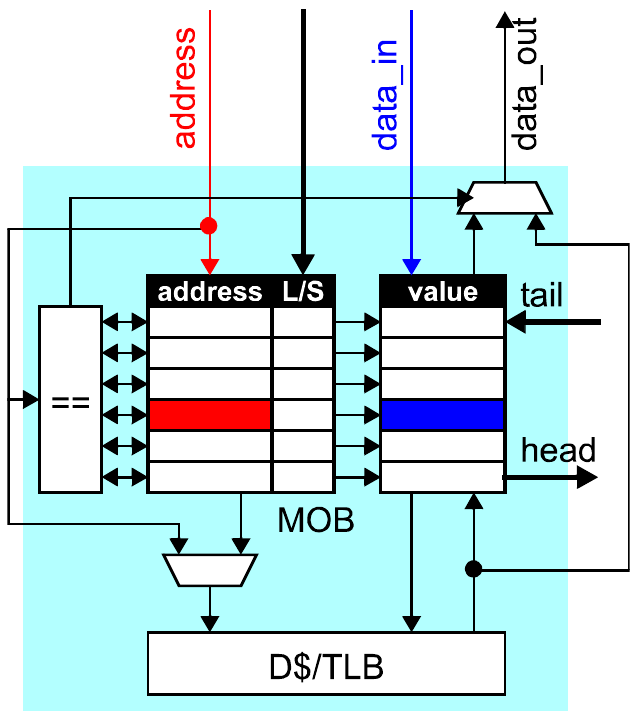

### Load Execution and Forwarding

Send the load address to the cache and MOB in parallel. The cache reads the addressed data while the MOB compares the address against **older active stores**, excluding younger stores even if they have executed already.

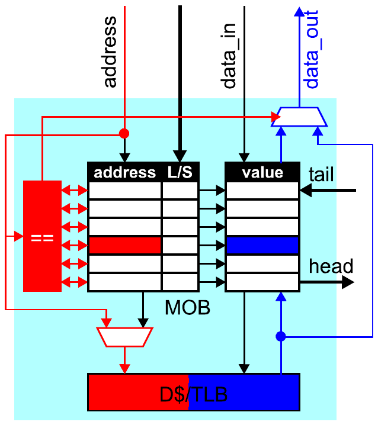

* **No older matching store:** use the cache value, provided older unresolved stores cannot invalidate this choice.
* **An older matching store with ready data:** forward from its MOB entry.
* **Several older matching stores:** forward from the **youngest matching store older than the load**, which is the most recent write in program order.
* **Matching store data not ready:** wait; an older cached value is not a valid substitute.


An older store with an unknown address leaves a possible dependency unresolved. A conservative policy waits for it; a speculative policy predicts independence and must detect violations and replay affected work if the prediction was wrong. The forwarding diagrams assume matching addresses and access sizes; partial overlaps need additional handling.

### Load/Store Retirement

At in-order retirement, free the corresponding entry at the MOB head. A load has already obtained its result, so it needs no memory write. A store sends its buffered address and value to `D$` before its entry can be released. Faulting or squashed stores never make that write.

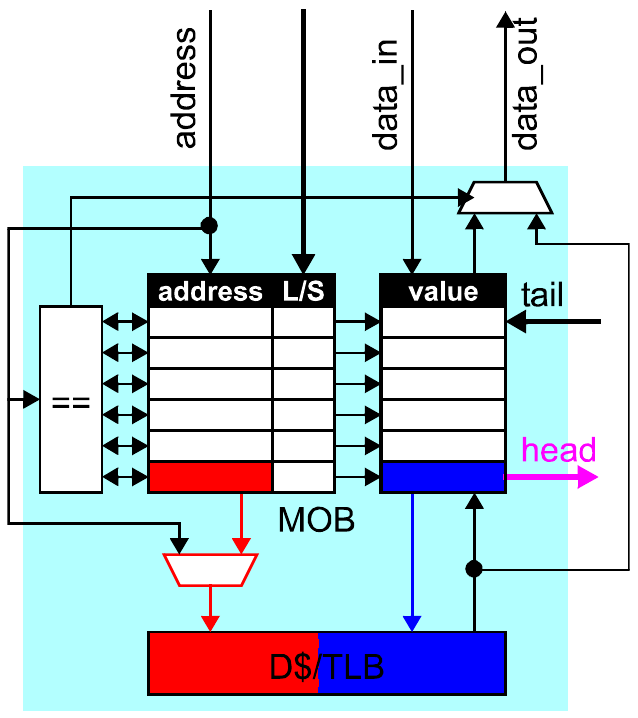
