# Multicore: Shared Memory Microprocessors

## Why Multiprocessors?

Firstly, performance. Instruction-level parallelism is limited, thus unicore performance is limited, and we can't even exploit all of the parallelism gained because we have to deal with branch prediction, cache misses, and other problems.

We also gain power efficiency; we can use more cores at lower frequencies and gain throughput (but maybe also gain latency).

## Uniprocessor Concurrency

Uniprocessor concurrency is enabled via software. Software threads have private per-thread state (PC, registers, stack) and shared state (globals, heap) and share the same memory address space. Processes are like threads but with individual memory space. Generally, the OS manages threads, and in a single-core system all threads share one processor.

## Simplest Multiprocessor

In the simplest multiprocessor, we replicate the entire processor pipeline, with the execption of caches. This gives us a **shared memory** model with loads and stores, where memory accesses from processors are interleaved.

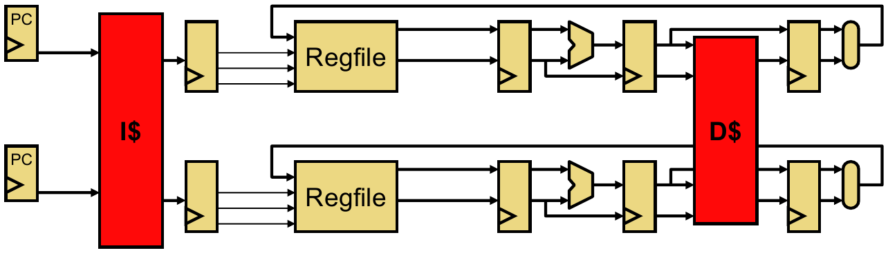

## Hardware Multithreading

In hardware multithreading, multiple threads dynamically share a single pipeline and caches. Replicating thread contexts in this case means replicating the PC and register file.


Multithreading improves utilization and throughput; single programs utilize <50% of the pipeline because of branches and cache misses, but multithreading does not improve single-thread performance. Invididual threads run as fast or even slower.

## Shared Memory Implementations


* Multiplexed Uniprocessor
  * Runtime system and/or OS occassionally pre-empts and swaps threads.
  * Interleaved, but no parallelism
* Multiprocessing
  * Multiply execution resources
* Hardware Multithreading
  * Tolerates pipeline latencies

All support the **shared memory programming model**.

### Issues

* Synchronization
  * How to regulate access to shared data?
  * How to implement critical sections?
* Cache coherence
  * How to make writes to a memory location "show up" to others?
* Memory consistency model

## Two Models for Communication

1. Message-passing
   * Communication occurs by explicitly passing messages among processors
2. **Shared memory**
   * **Communication occurs through a shared address space**

## Bank Accounts: Identifying Parallelism

Consider:

```c
struct acct_t { int balance; };
struct acct_t accounts[MAX_ACCT]; // current balances
struct trans_t { int id; int amount; };
struct trans_t transactions[MAX_TRANS]; // debit amounts
for (int i = 0; i < MAX_TRANS; i++) {
    int id = transactions[i].id;
    int amount = transactions[i].amount;
    if (accounts[id].balance >= amount) {
        accounts[id].balance -= amount;
    }
}
```

> Can we do this in parallel?

We can use thread-level parallelism. This is a collection of asynchronous tasks, not started and stopped together.

Address `accts` is shared, we can't allocate registers for it, so we must use loads and stores to obtain value:

* `x1`: holds `id`
* `x2`: holds debit amount
* `x3`: holds address to amount balance
* `x4`: holds balance

```c
struct acct_t { int bal; };
shared struct acct_t accts[MAX_ACCT];
int id, amt;
if (accts[id].bal >= amt) {
    accts[id].bal -= amt;
}
```

```asm
0: addi x3,x1,accts
1: lw x4, 0(x3)
2: blt x4,x2,done
3: sub x4,x4,x2
4: sw x4,0(x3)
```

Assume we have two $100 withdrawals from account `#241` at two ATMs, starting with a balance of $500. Each transaction is executed on a different processor. Important register values are:

* `x2` = 100,
* `x3` = address of `accts[241].bal`
* `x4` = the balance loaded into that thread's private register

### A Correct Execution

If thread 0 finishes before thread 1 reads the balance, the withdrawals behave as expected:

1. Thread 0 loads $500, checks that $100 is available, subtracts $100, and stores $400.
2. Thread 1 then loads $400, checks the balance, subtracts $100, and stores $300.


### A Problem Execution: Lost Update

The load, check, subtraction, and store are separate instructions. Another thread can access the balance between them.

1. Thread 0 loads $500 and computes $400 in its private `x4`, but is interrupted before its store. Shared memory still holds $500.
2. Thread 1 loads the same $500, computes $400, and stores it.
3. Thread 0 resumes and stores its previously computed $400, overwriting thread 1's update.

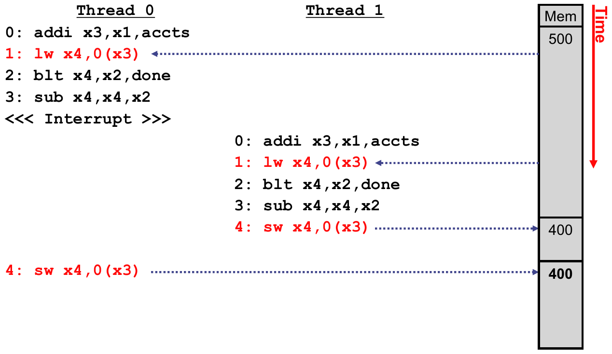

Both withdrawals succeed, but the final balance is **$400 instead of $300**. This is a **lost update**: the result depends on how the threads interleave. An interrupt illustrates the problem, but two processors executing concurrently can produce the same interleaving without one.

## Synchronization

Use a lock to provide **mutual exclusion**. Locks have two operations: `acquire(lock)` and `release(lock)`. The region between `acquire(lock)` and `release(lock)` is a **critical section**, which only one thread may enter at a time. A competing acquire must wait until the current owner releases the lock.

The entire balance check and update must be inside the critical section. Protecting only the final store would still let both threads compute from the same old balance.

```c
// Pseudocode: all accesses in this example use the same shared lock.
acquire(lock);
if (accts[id].bal >= amt) {
    accts[id].bal -= amt;
}
release(lock);
```

### A Synchronized Execution

1. Thread 0 acquires the lock, loads $500, and computes $400.
2. If thread 0 is interrupted before storing, it still holds the lock. Thread 1's acquire waits; in the slide it spins, repeatedly waiting for the lock to become available.
3. Thread 0 resumes, stores $400, and releases the lock.
4. Thread 1 acquires the lock, loads the updated $400, stores $300 after its withdrawal, and releases the lock.

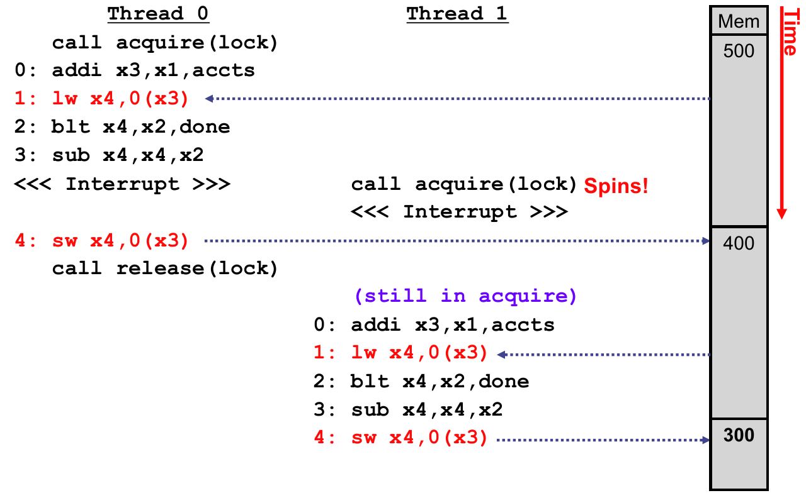

The final balance is now **$300**, even with the interruption. The lock serializes the withdrawals' critical sections, so a thread cannot observe another withdrawal halfway through its check-and-update sequence.

## Spin Lock

A spin lock is an implementation of a lock in software. A waiting thread "spins" while the lock is busy.

```c
acquire(lock):
  while (lock != 0) {}
  lock = 1;
```

```asm
A0: lw x6,0(&lock)
A1: bne x6,x0,A0
A2: addi x6,x6,1
A3: sw x6,0(&lock)
```

```c
release(lock):
  lock = 0;
```

### Incorrect Use

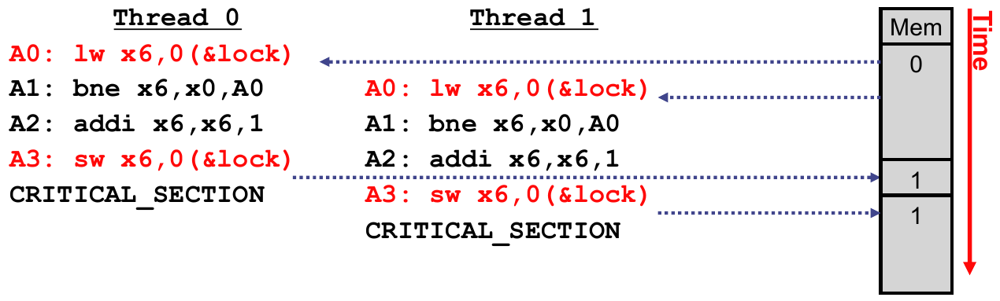

A spin lock makes intuitive sense, but doesn't actually work because the loads and stores of two `acquire` sequences can be interleaved, so the lock `acquire` sequence is not atomic. This is the same problem as before.

### SYSCALL Lock

```asm
A0: enable_interrupts
A1: disable_interrupts 
A2: lw x6,0(&lock)
A3: bne x6,x0,A0
A4: addi x6,x6,1
A5: sw x6,0(&lock)
A6: enable_interrupts
A7: return
```

By implementing the lock in a syscall, only the kernel can control interleaving by disabling interrupts. This works, however, it is largely inefficient due to the syscall overhead.

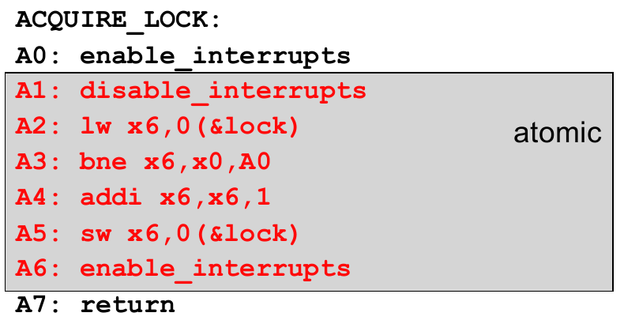

## Better Spin Lock: Atomic Swap

The RISC-V ISA provides an atomic lock acquisition instruction through extensions. An example of this would be atomic swap:

```asm
amoswap x1,0(&lock)

# Atomically executes:

mov x1->x2
lw 0(&lock)->x1
sw x2->0(&lock)
```

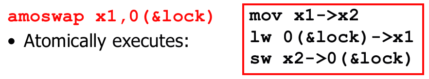

This gives us a new `acquire` sequence:
```asm
# x1 = 1
A0: amoswap x1,0(&lock)
A1: bne x1,x0,A0
```

If the lock was initially busy, we keep looping and it doesn't change. If it was initially free, we acquire it, set it to 1 and break from the loop.

## Implementing Atomic Swap

The implementation is non-trivial. We must ensure that memory operations are non-intervening, which requires temporarily blocking access by other threads.

If we use a single instruction we'd be combining a load and a store, which isn't very RISC like.

One approach is to provide a "load-reserved" and "store-conditional" instruction pair.


## Load-reserved and Store-conditional

`amoswap` as it stands is not very RISC with a load and a store in one instruction. If we broke it up into micro-ops, how would that be atomic?

With `LR/SC` (load-reserved/store-conditional):

```asm
LR 0(&lock)->x1
SC x2->0(&lock)
```

On `LR`, the processor loads the lock variable into `x1` and remembers address `0(&lock)` as reserved.

On `SC`, the processor looks for changes in the reserved address by other threads, if a change is detected then it returns failure, otherwise it writes to the same address, clears the reserved address and returns success.

## Lock Correctness

This lock actually works! Thread 1 keeps spinning. This is sometimes called a test-and-set lock.

However, it performs poorly. Consider 3 processors rather than 2, where processor 2 (not shown) has the lock and is in the critical section. Processor 0 and 1 are looping with `amoswap`, each of which includes an `LR/SC`, which generates useless traffic.

### Test-and-test-and-set locks

This is the solution to our poor performance:

```asm
A0: lw x1,0(&lock)
A1: bne x1,x0,A0
A2: addi x1,x1,1
A3: amoswap x1,0(&lock)
A4: bne x1,x0,A0
```

Before each `amoswap`, we do a simple test (`lw`) to see if the lock value has changed, and only execute `amoswap` if the lock is actually free.

Processors can spin on a busy lock locally (in their own cache).

## Private Caches and Shared Memory

Sharing L1 caches creates bandwidth and latency bottlenecks, with possible cache thrashing. Per-processor **private caches** reduce latency and increase throughput, but require a **cache coherence protocol** to coordinate their contents.

The shared-memory abstraction still applies even when processors have private caches, memory is physically distributed, and communication uses an interconnect.

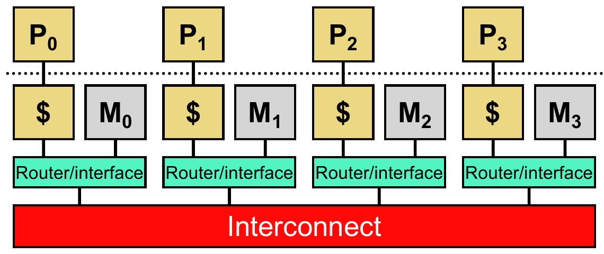

### Shared Cache Example

Revisit the two $100 withdrawals, with locks protecting the critical sections. Let `A` be the balance, initially $500.

* With no caches, the first withdrawal writes $400 to memory; the second reads $400 and writes $300.
* With one shared cache, P1's load brings `A = 500` into the cache. Its store changes the cached value to $400 and marks the block dirty; memory can remain at $500. Other processors access the same cached copy.
* The shared cache becomes a bottleneck when there are no per-core caches.

### Private Write-Back Caches: Incoherence

1. P1 loads `A = 500` into its private cache, then stores $400 there and marks its block dirty.
2. The shared cache and memory still contain $500.
3. P0 loads `A`, misses in its private cache, and receives the stale $500 from the shared cache instead of P1's $400.

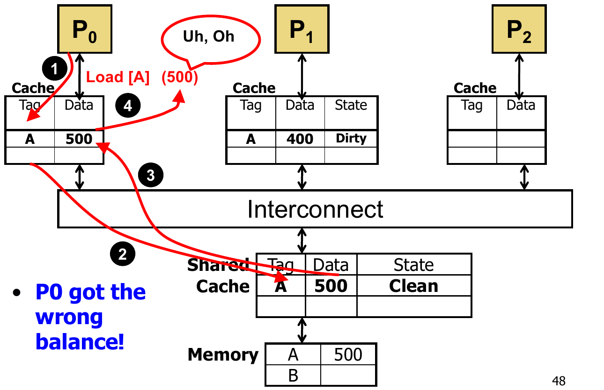

Locks alone do not solve this problem: even serialized critical sections need writes to become visible to other processors.

### Private Write-Through Caches

Write-through updates lower levels on every store, but does not automatically update other private caches.

1. P1 loads $500, then stores $400. Its cache, the shared cache, and memory now contain $400.
2. P0 loads $400 into its own cache, then stores $300. The shared cache and memory become $300.
3. P1 still has $400 in its private cache, so its next load can hit on stale data.

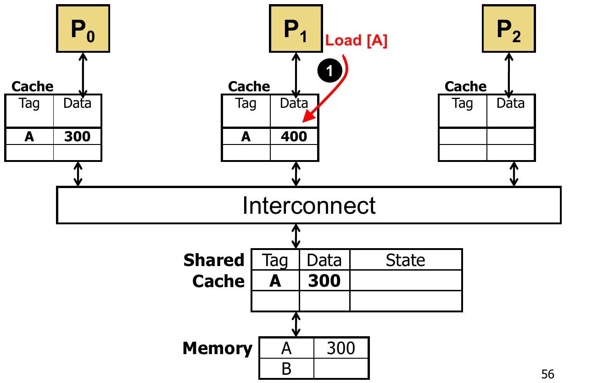

## Hardware Cache Coherence

Removing caches is too slow. Making all shared data uncacheable also hurts performance, while flushing all other caches on every shared write loses much of the benefit of caching. Hardware coherence coordinates copies with minimal flushing.

In a **bus-based multiprocessor**, all processors see bus requests in the same order. Each cache's **coherence controller (CC)** snoops bus addresses and data, then applies a protocol to its local blocks.

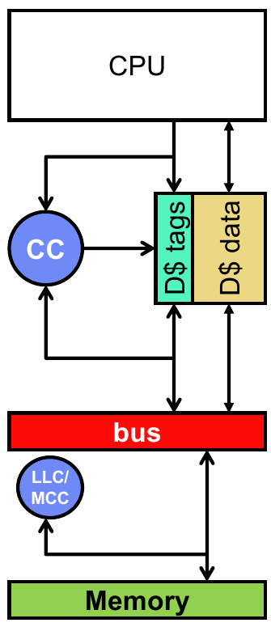

Two invariants guide coherence:

* **Single-writer-multiple-reader (SWMR):** for a location, either one core may write (and read), or multiple cores may only read.
* **Data-value invariant (DVI):** a read returns the value of the last write to that location.

### Coherence Events

| Source | Event | Meaning |
| --- | --- | --- |
| Local processor | `Load`, `Store` | Read or write a block |
| Local processor | `Repl` | Evict/write back a block |
| Local bus request | `OwnGetS` | Request a block for reading |
| Local bus request | `OwnGetM` | Request a block for writing |
| Local eviction | `PutS`, `PutM` | Release a shared or modified block |
| Another processor | `OtherGetS` | Another core's read miss |
| Another processor | `OtherGetM` | Another core's write request |

## VI (MI) Coherence Protocol

The **valid-invalid** protocol, also called modified-invalid, has two states per cached block: **V** means the cache has the block, and **I** means it does not. A valid bit can represent these states.

Only one cache may hold a valid copy. If another processor requests the block for reading or writing, the current holder supplies its data and invalidates its copy, writing back dirty data.

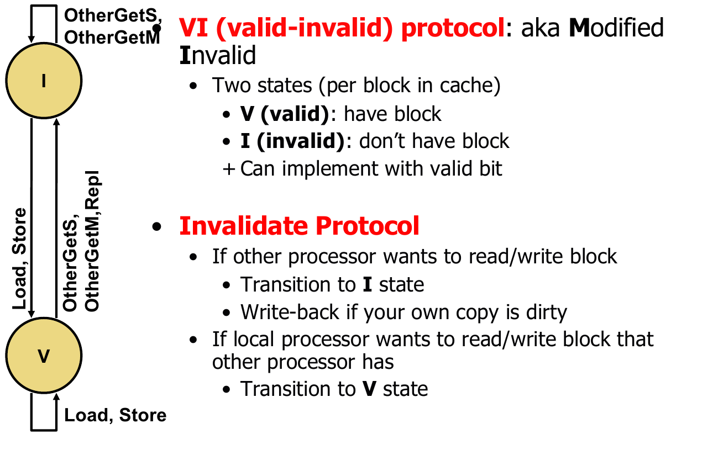

### Cache Controller Transitions

Each cell gives the action and resulting state; `-` means no action or state change.

| State | Local load/store | Replacement | `OtherGetS` | `OtherGetM` |
| --- | --- | --- | --- | --- |
| I | Issue `Get`; enter V | - | - | - |
| V | Hit; remain V | Issue `Put` with data; enter I | Send data; enter I | Send data; enter I |

`Send Data` transmits the block to memory and the requesting processor. Memory supplies data when no cache responds.

### Memory Controller Transitions

The memory controller also tracks the block's state. In the slide's memory-controller table:

| State | Bus `Get` | Bus `Put` | Bus `Send Data` |
| --- | --- | --- | --- |
| I | Send data; enter V | - | - |
| V | - | Update memory; enter I | Update memory; remain V |

### VI Withdrawal Example

| Event | P0 cache | P1 cache | Memory |
| --- | --- | --- | --- |
| Initially | I | I | 500 |
| P0 loads balance | V:500 | I | 500 |
| P0 stores after withdrawal | V:400 | I | 500 |
| P1 loads balance | I | V:400 | 400 |
| P1 stores after withdrawal | I | V:300 | 400 |

P1's load generates `OtherGetS` at P0. P0 sends its dirty $400 copy, updates memory, and enters I, so P1 receives the current balance.

VI is inefficient for read sharing: even read-only copies cannot coexist. Split V into modified and shared states to allow multiple readers.

## MSI Coherence Protocol

**Modified-shared-invalid (MSI)** allows either multiple read-only copies or a single read/write copy.

* **M (modified):** local dirty copy; this cache may read and write.
* **S (shared):** local clean copy; multiple caches may hold read-only copies.
* **I (invalid):** no usable local copy.

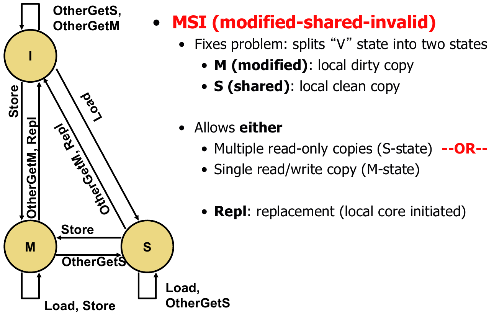

### Cache Controller Transitions

| State | Local load | Local store | Replacement | `OtherGetS` | `OtherGetM` |
| --- | --- | --- | --- | --- | --- |
| I | Issue `GetS`; enter S | Issue `GetM`; enter M | - | - | - |
| S | Hit | Issue `GetM`; enter M | Enter I | Remain S | Enter I |
| M | Hit | Hit | Issue `PutM`; enter I | Send data; enter S | Send data; enter I |

An **upgrade** occurs when a local store changes S to M. All other shared copies must become I before the local core can write.

### MSI with a Snoopy Bus: Load A

Initially, P1 holds `A = 500` in M. P0 and P2 have no copy. The shared cache and memory contain an older `A = 1000`; the shared cache marks A as modified in a private cache. `B = 0` is idle.

1. **Step 1 (slide 70):** P0's `Load A` misses.
2. **Step 2:** P0 broadcasts `GetS: Addr=A` on the bus.
3. **Step 3:** P1 snoops the request, responds with `A = 500`, and changes M to S.
4. **Step 4:** P0 receives $500 in S. The shared cache also receives $500 and becomes shared and dirty; main memory remains at $1000.
5. **Step 5:** P0's load returns $500. P0 and P1 now both hold A in S.

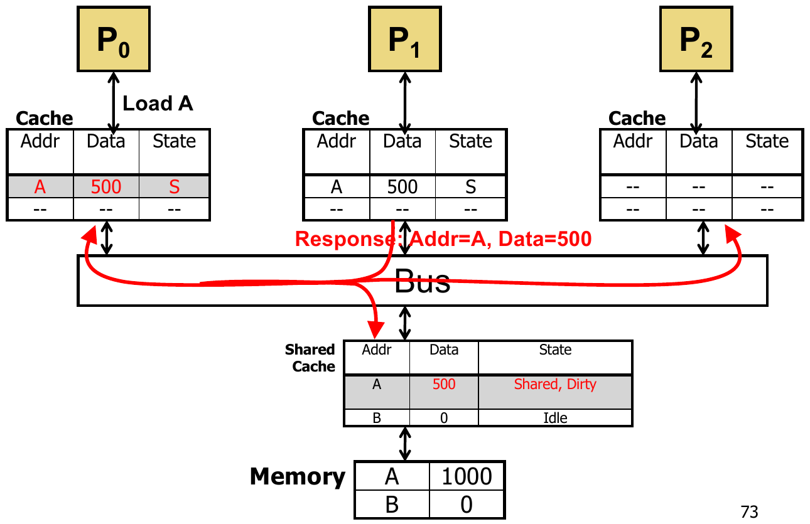

Here the private S copies are clean relative to the shared cache; the shared cache remains dirty relative to main memory.

### MSI with a Snoopy Bus: Store A

6. **Step 6 (slide 75):** P0 wants to store $400 to A, but its S copy requires an upgrade.
7. **Step 7 (slide 76):** P0 broadcasts `GetM: Addr=A` to request write permission. At this point in the example, both private copies still show S with $500; the shared cache holds $500, and memory holds $1000.

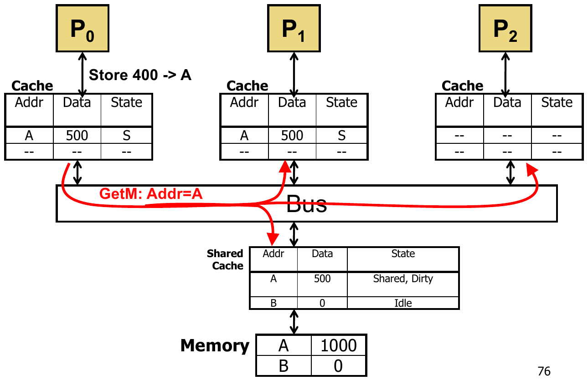
