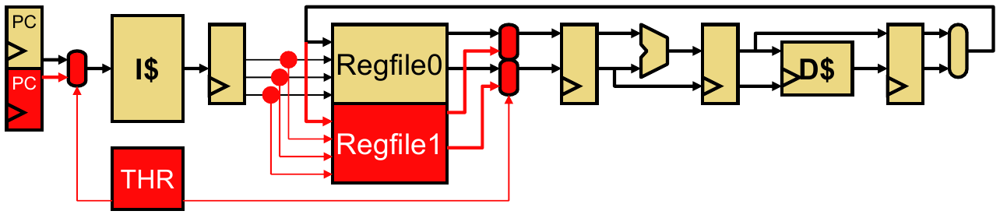
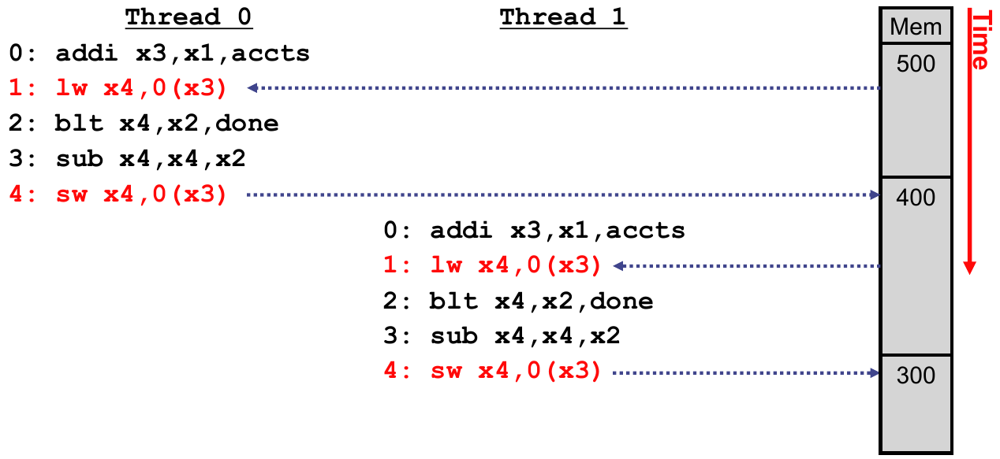

# Multicore: Shared Memory Microprocessors

## Why Multiprocessors?

Firstly, performance. Instruction-level parallelism is limited, thus unicore performance is limited, and we can't even exploit all of the parallelism gained because we have to deal with branch prediction, cache misses, and other problems.

We also gain power efficiency; we can use more cores at lower frequencies and gain throughput (but maybe also gain latency).

## Uniprocessor Concurrency

Uniprocessor concurrency is enabled via software. Software threads have private per-thread state (PC, registers, stack) and shared state (globals, heap) and share the same memory address space. Processes are like threads but with individual memory space. Generally, the OS manages threads, and in a single-core system all threads share one processor.

## Simplest Multiprocessor

In the simplest multiprocessor, we replicate the entire processor pipeline, with the execption of caches. This gives us a **shared memory** model with loads and stores, where memory accesses from processors are interleaved.


## Hardware Multithreading

In hardware multithreading, multiple threads dynamically share a single pipeline and caches. Replicating thread contexts in this case means replicating the PC and register file.



Multithreading improves utilization and throughput; single programs utilize <50% of the pipeline because of branches and cache misses, but multithreading does not improve single-thread performance. Invididual threads run as fast or even slower.

## Shared Memory Implementations


* Multiplexed Uniprocessor
  * Runtime system and/or OS occassionally pre-empts and swaps threads.
  * Interleaved, but no parallelism
* Multiprocessing
  * Multiply execution resources
* Hardware Multithreading
  * Tolerates pipeline latencies

All support the **shared memory programming model**.

### Issues

* Synchronization
  * How to regulate access to shared data?
  * How to implement critical sections?
* Cache coherence
  * How to make writes to a memory location "show up" to others?
* Memory consistency model

## Two Models for Communication

1. Message-passing
   * Communication occurs by explicitly passing messages among processors
2. **Shared memory**
   * **Communication occurs through a shared address space**

## Bank Accounts: Identifying Parallelism

Consider:

```c
struct acct_t { int balance; };
struct acct_t accounts[MAX_ACCT]; // current balances
struct trans_t { int id; int amount; };
struct trans_t transactions[MAX_TRANS]; // debit amounts
for (int i = 0; i < MAX_TRANS; i++) {
    int id = transactions[i].id;
    int amount = transactions[i].amount;
    if (accounts[id].balance >= amount) {
        accounts[id].balance -= amount;
    }
}
```

> Can we do this in parallel?

We can use thread-level parallelism. This is a collection of asynchronous tasks, not started and stopped together.

Address `accts` is shared, we can't allocate registers for it, so we must use loads and stores to obtain value:

* `x1`: holds `id`
* `x2`: holds debit amount
* `x3`: holds address to amount balance
* `x4`: holds balance

```c
struct acct_t { int bal; };
shared struct acct_t accts[MAX_ACCT];
int id, amt;
if (accts[id].bal >= amt) {
    accts[id].bal -= amt;
}
```

```asm
0: addi x3,x1,accts
1: lw x4, 0(x3)
2: blt x4,x2,done
3: sub x4,x4,x2
4: sw x4,0(x3)
```

Assume we have two $100 withdrawals from account `#241` at two ATMs, starting with a balance of $500. Each transaction is executed on a different processor. Important register values are:

* `x2` = 100,
* `x3` = address of `accts[241].bal`
* `x4` = the balance loaded into that thread's private register

### A Correct Execution

If thread 0 finishes before thread 1 reads the balance, the withdrawals behave as expected:

1. Thread 0 loads $500, checks that $100 is available, subtracts $100, and stores $400.
2. Thread 1 then loads $400, checks the balance, subtracts $100, and stores $300.



### A Problem Execution: Lost Update

The load, check, subtraction, and store are separate instructions. Another thread can access the balance between them.

1. Thread 0 loads $500 and computes $400 in its private `x4`, but is interrupted before its store. Shared memory still holds $500.
2. Thread 1 loads the same $500, computes $400, and stores it.
3. Thread 0 resumes and stores its previously computed $400, overwriting thread 1's update.


Both withdrawals succeed, but the final balance is **$400 instead of $300**. This is a **lost update**: the result depends on how the threads interleave. An interrupt illustrates the problem, but two processors executing concurrently can produce the same interleaving without one.

### Synchronizing Access to the Balance

Use a lock to provide **mutual exclusion**. The region between `acquire(lock)` and `release(lock)` is a **critical section**, which only one thread may enter at a time. A competing acquire must wait until the current owner releases the lock.

The entire balance check and update must be inside the critical section. Protecting only the final store would still let both threads compute from the same old balance.

```c
// Pseudocode: all accesses in this example use the same shared lock.
acquire(lock);
if (accts[id].bal >= amt) {
    accts[id].bal -= amt;
}
release(lock);
```

### A Synchronized Execution

1. Thread 0 acquires the lock, loads $500, and computes $400.
2. If thread 0 is interrupted before storing, it still holds the lock. Thread 1's acquire waits; in the slide it spins, repeatedly waiting for the lock to become available.
3. Thread 0 resumes, stores $400, and releases the lock.
4. Thread 1 acquires the lock, loads the updated $400, stores $300 after its withdrawal, and releases the lock.


The final balance is now **$300**, even with the interruption. The lock serializes the withdrawals' critical sections, so a thread cannot observe another withdrawal halfway through its check-and-update sequence.
